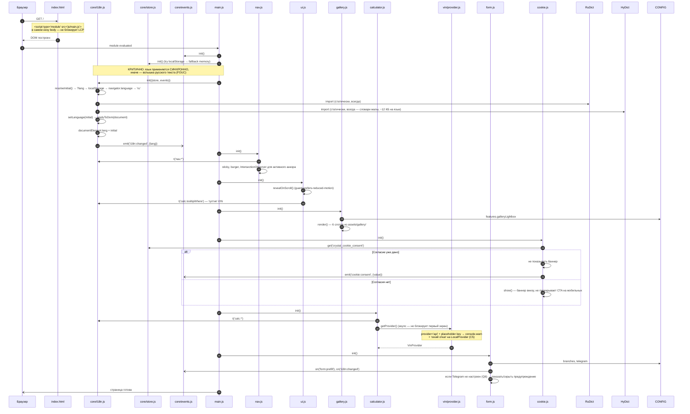
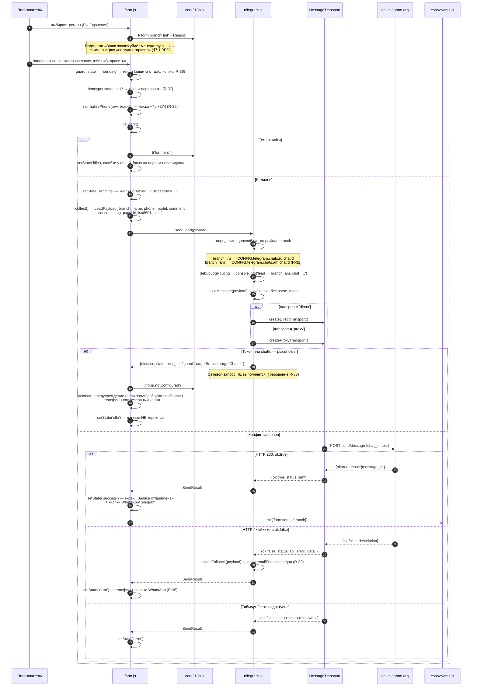
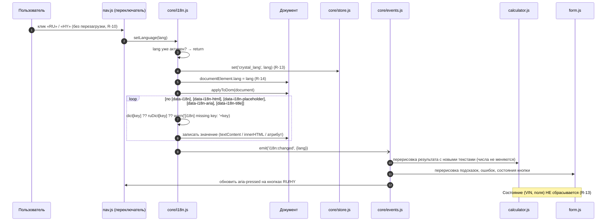
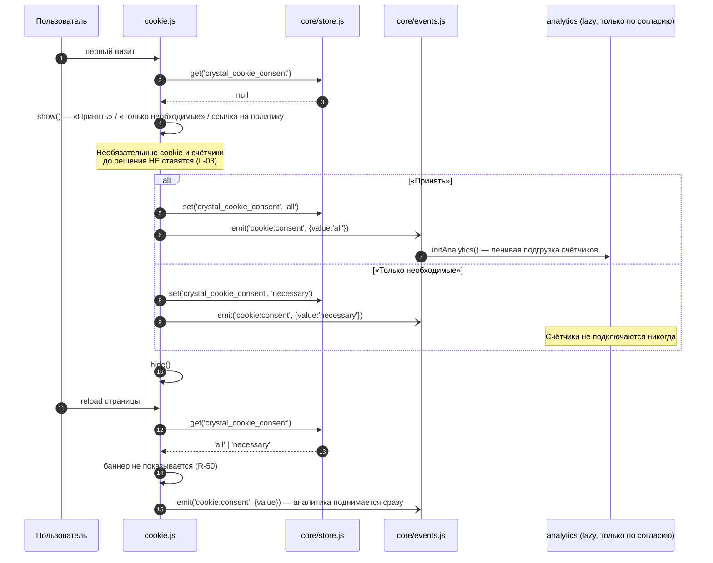
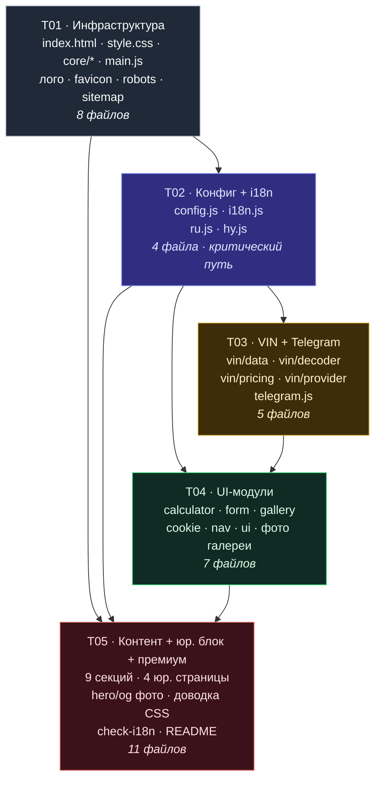

# ARCHITECTURE — Сайт детейлинг-центра «Crystal»

| Поле | Значение |
|---|---|
| **Документ** | Архитектура + декомпозиция задач |
| **Проект** | `crystal-detailing` (Липецк, РФ + Армения) |
| **Вход** | `docs/PRD.md` v1.0 (подготовил продуктовый менеджер) |
| **Автор** | Архитектор (Bob / Gao) |
| **Язык документа** | Русский |
| **Языки сайта** | `ru` (основной), `hy` (армянский) |
| **Дата** | 2026-11-09 |
| **Статус** | Утверждено к реализации |
| **Целевой исполнитель** | Инженер (engineer), задача #3 |

---

## 0. Резюме архитектурных решений

Пять решений, определяющих всю дальнейшую работу. Всё остальное — следствия.

1. **Стек:** чистые `HTML5 + CSS3 + Vanilla JS (ES-модули)`, без сборщика, без npm. Единственная внешняя зависимость — Google Fonts через `<link>`. Всё остальное (иконки — inline SVG, изображения — локальные) отдаётся с того же origin.
2. **Мультиязычность:** `data-i18n`-атрибуты + плоские JS-словари, **не** отдельные HTML-деревья. Причина — R-11 требует отсутствия зашитых строк, а поддержка двух копий разметки вручную даёт гарантированный дрейф. См. §1.3.
3. **VIN-модуль:** трёхслойная схема `provider → data → pricing`, где `provider` — точка расширения под внешний API. UI (`calculator.js`) никогда не знает, откуда пришли данные: он вызывает `VinProvider.decode(vin): Promise<VehicleInfo>`. См. §3.3.
4. **Telegram:** транспорт за интерфейсом `MessageTransport`; две реализации — `DirectTransport` (браузер → Bot API, работает «как есть», **токен утекает**) и `ProxyTransport` (сайт → serverless-прокси → Bot API, **рекомендуется для продакшена**). Переключение — одной строкой в `js/config.js`. Риск утечки задокументирован в §5.4 и в `README.md`. См. §3.5.
5. **Юридический блок:** отдельные физические страницы (`legal/privacy-ru.html`, `legal/privacy-am.html`, `legal/consent.html`, `legal/cookies.html`), а **не** модальные окна и не разделы в i18n-словарях. Причина — юр. текст обязан иметь свой URL, а тексты в словаре раздувают бандл для всех посетителей. См. §1.4.

---

# Часть A. Проектирование системы

## 1. Подход к реализации

### 1.1 Ключевые технические вызовы

| # | Вызов | Почему сложно | Выбранное решение |
|---|---|---|---|
| **C1** | Двуязычность без сборщика | Нужны и SEO (`hreflang`, `lang`), и мгновенное переключение без перезагрузки, и сохранение выбора | `data-i18n` + словари `ru.js`/`hy.js`; ключи плоские; интерполяция `{value}`; откат на `ru` при пропущенном ключе с `console.warn` |
| **C2** | Армянский текст длиннее русского | Разрушение вёрстки: кнопки разъезжаются, навигация переносится на 2 строки, карточки меняют высоту → CLS | Правило «никаких фиксированных ширин под текст»: `min-width` вместо `width`, `flex-wrap` в навбаре, `clamp()` для заголовков, `overflow-wrap: anywhere` в карточках. Тест на `hy` — обязательный пункт QA |
| **C3** | VIN-расшифровка офлайн | Полная база WMI — сотни записей; символы 4–8 неоднозначны; год кодируется по-разному до/после 2010 | Намеренно **неполная, но честная** таблица: ~120 самых частых для РФ/Армении WMI; отдельный путь «выбрать класс вручную». Результат подаётся как ориентир с `confidence` |
| **C4** | Утечка токена Telegram | Прямой `fetch` к `api.telegram.org` из браузера раскрывает токен любому, кто откроет DevTools | Двойной транспорт (§3.5). Прямой режим — для демо и быстрого запуска; прокси — рекомендация продакшена; предупреждение в консоли в обоих случаях |
| **C5** | Демо-режим без падений | Все конфиги — placeholder'ы, но сайт должен быть полностью работоспособен (R-33, R-63) | Центральный `config.js` хранит незаполненные значения как строку `'[ЗАПОЛНИТЬ]'`; хелпер `Config.isPlaceholder(v)` — единая точка проверки; UI реагирует предупреждением, а не исключением |
| **C6** | Премиальная эстетика в vanilla CSS | Нет Tailwind/MUI, нет design-tokens из коробки | Одноуровневые CSS-переменные в `:root`, минимум утилитарных классов, «стеклянные» панели через `backdrop-filter`, анимации через `IntersectionObserver` + уважение `prefers-reduced-motion` |
| **C7** | Два юр. текста × два языка | 4 комбинации, длинные тексты, реквизиты — placeholder'ы | Физические HTML-страницы с якорными разделами; тексты **не** в i18n-словарях (в i18n — только хром: шапка/футер/кнопка «назад»). Решение: **страница на юрисдикцию и язык**. См. §1.4 |

### 1.2 Выбор фреймворков и библиотек

**Никаких фреймворков.** Обоснование: PRD фиксирует «без сборщика» (R-60), anti-goals исключают SPA-роутинг. React/Vue без сборщика требуют либо CDN-UMD (тяжёлый, ломает ES-модульность), либо `importmap` + JSX-транспиляцию в браузере (медленно, нестабильно). Для одностраничного лендинга с 9 секциями это чистый проигрыш по LCP (G1 требует ≥ 85).

| Слой | Выбор | Обоснование |
|---|---|---|
| Разметка | Семантический HTML5 | R-64 (Accessibility ≥ 90), SEO |
| Стили | Vanilla CSS, один `style.css`, `@layer` | Контроль каскада без сборщика; один HTTP-запрос вместо многих |
| Логика | ES2022-модули (`<script type="module">`) | Нативная модульность, изоляция VIN-модуля (R-20) |
| Шрифты | Google Fonts: `Inter` + `Noto Sans Armenian` | R-14. `<link rel="preconnect">` + `display=swap` |
| Иконки | Inline SVG-спрайт в `index.html` (`<symbol>`) | Нет внешней зависимости, нет мерцания, цвет через `currentColor` |
| Карта | Ссылка на Яндекс.Карты (без iframe) | iframe-карта бьёт по LCP и ставит сторонние cookie до согласия (нарушает L-03) |

### 1.3 Решение по i18n и его обоснование

**Вариант (б) — отдельные HTML-файлы (`index.html` / `index.hy.html`)** — отклонён. Причины: (1) любая правка разметки дублируется → дрейф; (2) переключение языка требует перезагрузки, что противоречит R-10 («без перезагрузки»); (3) две копии длинного лендинга ≈ +25 КБ HTML на каждый визит; (4) 9 секций × 2 языка = риск расхождения `id`/`class`, на которые ссылаются CSS и JS.

**Вариант (а) — `data-i18n` + JS-словари — принят.** Детали:

- Ключи плоские, нотация `section.element`: `hero.title`, `services.card1.price`, `form.err.phone`.
- Типы атрибутов: `data-i18n` (textContent), `data-i18n-html` (innerHTML — **только** для строк с инлайн-разметкой, значение санитизируется белым списком тегов `<b> <i> <br> <a> <strong> <span>`), `data-i18n-placeholder` (атрибут `placeholder`), `data-i18n-aria` (`aria-label`), `data-i18n-title` (`title`), `data-i18n-value` (значение `<option>`).
- Сохранение: `localStorage['crystal_lang']` (R-13) через `js/core/store.js`.
- Приоритет при загрузке: `?lang=` (R-16) → `localStorage` → `navigator.language` (R-15) → `ru`.
- `<html lang>` обновляется; `dir` всегда `ltr` (армянский — LTR).
- Отсутствующий ключ: откат на `ru`, затем `console.warn('[i18n] missing key: ...')`; в UI никогда не пустая строка.
- **SEO-компромисс (важно понимать):** при одностраничной схеме поисковый робот видит только язык по умолчанию. Для честного `hreflang` инженер добавляет в `<head>` три `<link rel="alternate">`: `ru`, `hy`, `x-default` — все на `index.html` с разными `?lang=`. Это даёт корректный сигнал Google, но не индексирует армянский контент отдельно. Полная индексация двух языков требует варианта (б). **Принятое решение соответствует PRD** (R-16 — P2, отдельная индексация не требуется), но фиксируется как осознанный компромисс, а не недосмотр.

### 1.4 Юридические тексты: обоснование

Отклонены: (1) модальные окна — юр. текст должен иметь URL; (2) разделы внутри i18n-словаря — раздувают бандл и требуют экранирования HTML в строках.

**Принято:** 4 отдельные HTML-страницы, каждая со своим `lang`, тёмная тема с увеличенным `line-height` и ограничением ширины текста (читаемость юридического документа).

| Файл | Содержание | Язык |
|---|---|---|
| `legal/privacy-ru.html` | Политика конфиденциальности для РФ (152-ФЗ), 12 разделов по §8.1 PRD | `ru` |
| `legal/privacy-am.html` | Политика конфиденциальности для Армении (Закон РА ЗР-49), 10 разделов по §8.2 PRD | `hy` |
| `legal/consent.html` | Согласие на обработку ПД, покрывающее **обе** юрисдикции (R-53, L-07) | `ru` + `hy` секциями |
| `legal/cookies.html` | Cookie-политика с таблицей cookie (R-59) | `ru` + `hy` секциями |

Все четыре используют общий `css/style.css` (слой `legal`), упрощённую шапку и общий футер. Реквизиты везде — `[ЗАПОЛНИТЬ]`.

### 1.5 Архитектурный паттерн

**Модульный монолит на уровне сборки, MVVM-lite на уровне рантайма.**

- **Model** — `js/vin/*`, `js/config.js`, `js/core/store.js`.
- **View** — `index.html` + `css/style.css` (+ `js/core/dom.js` для динамических списков: галерея, соцкнопки, список услуг из конфига).
- **ViewModel** — `js/calculator.js`, `js/form.js`, `js/core/i18n.js`: держат состояние UI и синхронизируют его с Model.
- **Связывание** — через `js/core/events.js` (`CustomEvent`) вместо прямых вызовов: `i18n:changed`, `calc:result`, `calc:reset`, `form:prefill`, `cookie:consent`. Это разводит порядок загрузки и исключает циклические импорты.
- **Bootstrapping** — единственный тег `<script type="module" src="js/main.js"></script>` перед `</body>`. Остальное — статические `import`. `main.js` **синхронно** применяет язык к уже отрендеренному HTML (защита от вспышки неверного языка), затем асинхронно инициализирует провайдер VIN, галерею и остальное.

---

## 2. Полный список файлов

Обозначения: 🆕 создать · 📄 контент/документация.

```
crystal-detailing/
│
├── index.html                          🆕  Главная (9 секций, single-page, якорная навигация)
├── README.md                           🆕  Инструкция заказчику: что где заменить (R-67)
├── robots.txt                          🆕  Правила для роботов (SEO)
├── sitemap.xml                         🆕  Карта: index + 4 юр. страницы
│
├── css/
│   ├── style.css                       🆕  ЕДИНЫЙ файл. Слои: reset → tokens → base → layout →
│   │                                       components → sections → utilities → responsive → legal
│   └── README-STYLE.md                 📄  Карта CSS: что за что отвечает (для правок заказчиком)
│
├── js/
│   ├── config.js                       🆕  ⚠️ ЕДИНСТВЕННАЯ точка настройки контента. Все placeholder'ы
│   ├── main.js                         🆕  Точка входа: bootstrap-последовательность (§4.1)
│   │
│   ├── core/
│   │   ├── i18n.js                     🆕  Движок i18n: setLanguage, t(), applyToDom()
│   │   ├── store.js                    🆕  Безопасный localStorage (quota/private-mode → memory fallback)
│   │   ├── dom.js                      🆕  $, $$, el(), renderList(), setText(), escapeHtml()
│   │   └── events.js                   🆕  Шина событий (on/off/emit)
│   │
│   ├── i18n/
│   │   ├── ru.js                       🆕  Русский словарь (источник истины по составу ключей)
│   │   └── hy.js                       🆕  Армянский словарь (литературный перевод, тот же набор ключей)
│   │
│   ├── vin/
│   │   ├── data.js                     🆕  Таблицы: WMI (~120), модельные префиксы, множители классов,
│   │   │                                   базовая матрица цен, кодировка года
│   │   ├── decoder.js                  🆕  validateVin(), decodeVinLocal(): WMI → марка/регион, год, модель
│   │   ├── pricing.js                  🆕  resolveClass(), calcRange(): цена × множитель класса → диапазон
│   │   └── provider.js                 🆕  LocalProvider / ApiProvider, getProvider() — ТОЧКА РАСШИРЕНИЯ API
│   │
│   ├── calculator.js                   🆕  ViewModel VIN-блока: ввод → валидация → расчёт → префилл формы
│   ├── form.js                         🆕  Валидация формы, маска телефона, сбор payload, состояния кнопки
│   ├── telegram.js                     🆕  MessageTransport: DirectTransport / ProxyTransport, маршрутизация
│   ├── gallery.js                      🆕  Рендер сетки галереи из конфига + лайтбокс
│   ├── cookie.js                       🆕  Cookie-баннер, consent-хук для аналитики (R-50, R-51, L-01..L-03)
│   ├── nav.js                          🆕  Sticky-шапка, burger-меню, активный анкор, плавный скролл
│   └── ui.js                           🆕  Reveal-анимации по скроллу, тултипы, аккордеоны, копирование
│
├── legal/
│   ├── privacy-ru.html                 🆕  Политика конфиденциальности РФ (152-ФЗ)
│   ├── privacy-am.html                 🆕  Политика конфиденциальности Армении (ЗР-49)
│   ├── consent.html                    🆕  Согласие на обработку ПД (обе юрисдикции)
│   └── cookies.html                    🆕  Cookie-политика + таблица cookie
│
├── assets/
│   ├── logo-placeholder.svg            🆕  Временный логотип «CRYSTAL» (заменить на бренд)
│   ├── favicon.svg                     🆕  Иконка вкладки (SVG)
│   ├── og-image-placeholder.jpg        🆕  OG-картинка-заглушка 1200×630 (заменить)
│   ├── hero-placeholder.jpg            🆕  Фон Hero 1920×1080 (заменить)
│   └── gallery/
│       ├── README.md                   📄  Инструкция: photo-1.jpg … photo-6.jpg, 1600×1200, ≤400 КБ
│       └── photo-1.jpg … photo-6.jpg   🆕  6 заглушек-слотов (премиум-заглушки, не битые ссылки)
│
├── tools/
│   └── check-i18n.js                   🆕  Валидатор: ключи ru ↔ hy без пропусков/пустых (для QA)
│
└── docs/
    ├── PRD.md                          📄  Уже создан продуктовым менеджером
    ├── ARCHITECTURE.md                 📄  Этот документ
    ├── class-diagram.mermaid           📄  Выгрузка диаграммы классов (§3)
    ├── sequence-diagram.mermaid        📄  Выгрузка диаграмм последовательности (§4)
    └── QA-REPORT.md                    📄  Отчёт QA (создаёт тестировщик)
```

**Итого:** 34 артефакта; 27 из них — код/разметка/ресурсы, создаваемые инженером.

### 2.1 Соответствие именам из PRD (важно для инженера)

PRD §5 фиксирует структуру каталогов, но два имени в ней отличаются от принятых здесь. Отличия осознанные — сводка, чтобы не было расхождений при реализации.

| В PRD §5 | В этой архитектуре | Почему изменено |
|---|---|---|
| `js/vin/classes.js` | `js/vin/pricing.js` | Файл содержит не только маппинг «модель → класс», но и расчёт цены, диапазона и форматирование. Имя `pricing.js` точнее описывает содержимое. Маппинг классов при этом **не** вынесен в отдельный файл — он внутри `data.js` (`CLASS_TABLE`), а логика резолва — в `pricing.js` |
| `js/i18n/` (только словари) + подразумеваемый `i18n/index.js` в §9 PRD | Движок — `js/core/i18n.js`, словари — `js/i18n/{ru,hy}.js` | Движок i18n — не «словарный» код, а инфраструктурный: он держит состояние языка, пишет в `store`, шлёт события. Поэтому он в `core/`, рядом с `store.js` и `events.js`, от которых зависит. В `js/i18n/` остаются **только** данные переводов — это чище и позволяет `check-i18n.js` читать каталог целиком |
| `config.js` → `PROXY_URL` | `config.js` → `CONFIG.telegram.proxyUrl` | Единая вложенная структура конфига вместо плоских глобальных констант: `CONFIG.telegram.{transport, botToken, proxyUrl, chats, …}`. Плоские имена вида `TELEGRAM_CHAT_ID_RU` из текста PRD в коде не используются — вместо них `CONFIG.telegram.chats.ru.chatId`. В комментариях `config.js` старые имена упоминаются для узнаваемости |

Порядок подключения скриптов: `index.html` содержит **ровно один** тег `<script type="module" src="js/main.js"></script>` в конце `<body>`. Все остальные модули подключаются статическими `import` внутри графа — порядок тегов в HTML не важен и не может быть нарушен. Это снимает главный риск схемы «без сборщика»: при ES-модулях браузер сам разрешает граф зависимостей, и ручная сортировка тегов не требуется.

### 2.2 Пояснения по ключевым файлам

| Файл | Почему именно так |
|---|---|
| `js/config.js` | По R-62 — **единственная** точка правки контента. Один `default export CONFIG` + утилиты `isPlaceholder`, `isReady`. Блоки: `brand`, `branches`, `social`, `telegram`, `vin`, `pricing`, `legal`, `analytics`, `features`. |
| `js/telegram.js` | Вынесен из `form.js`, потому что транспорт — независимая от UI сущность: переиспользуется (заявка из калькулятора, «перезвоните мне»), тестируется без DOM, и именно тут концентрируется риск C4. |
| `js/vin/provider.js` | Единственный файл, знающий о существовании внешнего API. Замена `local`→`api` не должна касаться ни `calculator.js`, ни разметки. Требование R-26. |
| `js/core/store.js` | `localStorage` бросает исключения в приватном режиме Safari и при переполнении. Обёртка с `try/catch` и in-memory fallback не даёт сайту упасть (актуально для iOS). |
| `tools/check-i18n.js` | Позволяет QA механически проверить R-11 и L-06 без ручного перебора ~210 ключей: `node tools/check-i18n.js`. |

---

## 3. Структуры данных и интерфейсы

### 3.1 Конфигурация (`js/config.js`)

Единственная точка правки контента (R-62). Один объект + три утилиты.

```js
/** @typedef {string} MaybePlaceholder  // '[ЗАПОЛНИТЬ]' = заказчик ещё не дал значение */

export const CONFIG = {
  brand: { name: 'Crystal', logo: 'assets/logo-placeholder.svg',
           ogImage: 'assets/og-image-placeholder.jpg' },

  /** @type {{ ru: Branch, am: Branch }} */
  branches: {
    ru: { id: 'ru', city: 'Липецк', address: 'Универсальный проезд, 1Г', addressExtra: '',
          phone: '+7 (915) 550-17-77', phoneRaw: '+79155501777',
          mapUrl: 'https://yandex.ru/maps/?text=Липецк, Универсальный проезд, 1Г',
          telegramBranch: 'ru', phonePrefix: '+7', phoneDigits: 10 },
    am: { id: 'am', city: '[ЗАПОЛНИТЬ]', /* Ереван? — Q5 */ address: '[ЗАПОЛНИТЬ]',
          addressExtra: '', phone: '[ЗАПОЛНИТЬ]', /* +374 … */ phoneRaw: '',
          mapUrl: '[ЗАПОЛНИТЬ]', telegramBranch: 'am',
          phonePrefix: '+374', phoneDigits: 8 },
  },

  social: { whatsapp: '[ЗАПОЛНИТЬ]', telegram: '[ЗАПОЛНИТЬ]', instagram: '[ЗАПОЛНИТЬ]' },

  telegram: {
    /**
     * ТРАНСПОРТ — ключевая развилка безопасности (см. §5.4).
     * 'direct': браузер → api.telegram.org. Работает «как есть», но токен виден
     *           в DevTools любому посетителю. ТОЛЬКО для демо и приёмки.
     * 'proxy' : сайт → serverless-прокси → api.telegram.org. Токен на сервере.
     *           РЕКОМЕНДУЕТСЯ ДЛЯ ПРОДАКШЕНА.
     * @type {'direct'|'proxy'}
     */
    transport: 'direct',
    botToken: '[ЗАПОЛНИТЬ]',      // от @BotFather — утекает в direct-режиме
    proxyUrl: '[ЗАПОЛНИТЬ]',      // https://<project>.vercel.app/api/telegram
    apiBase: 'https://api.telegram.org',
    timeoutMs: 10000,

    /** Разные чаты для РФ и Армении — ядро требования R-32 */
    chats: {
      ru: { chatId: '[ЗАПОЛНИТЬ]', enabled: true },
      am: { chatId: '[ЗАПОЛНИТЬ]', enabled: true },
    },

    fallbackEmail: '[ЗАПОЛНИТЬ]',      // резервный канал (R-39, P2)
    emailEndpoint: '[ЗАПОЛНИТЬ]',
    showConfigWarningToUser: true,     // Q6: показывать ли предупреждение посетителю
    debugLogRouting: true,             // консольный лог маршрута — отладка R-32
  },
```

```js
  vin: {
    provider: 'local',            // 'local' | 'api' — развилка провайдера (R-26)
    apiBase: '[ЗАПОЛНИТЬ]',       // https://api.vincario.com/v2
    apiKey: '[ЗАПОЛНИТЬ]',
    apiTimeoutMs: 8000,
    fallbackToLocal: true,        // тихий откат на офлайн-декодер при ошибке API
  },

  pricing: {
    /** Множители классов 1–5. Класс 3 = 1.00 — точка отсчёта (Q3) */
    classMultipliers: { 1: 0.75, 2: 1.00, 3: 1.15, 4: 1.55, 5: 2.10 },

    rangeLowFactor: 0.90,         // диапазон: [итог × 0.9 … ]
    rangeHighFactor: 1.20,        //            [ … итог × 1.2]

    /**
     * Округление цен — до сотен, в JS-семантике «половина ВВЕРХ»:
     *
     *     const r = v => Math.round(v / 100) * 100;   // roundTo = 100
     *
     * ВАЖНО: Math.round(178.5) === 179 (половина вверх), тогда как Python
     * round(178.5) === 178 (банковское, к чётному). Расхождение возникает
     * РОВНО на значениях, где делённое на 100 даёт .5, и даёт разницу в 100 ₽.
     * Именно из-за этого архитектурный документ и код один раз разошлись
     * (кл. 5 комплекс-мойки: 17 850 → JS 17 900, Python 17 800).
     *
     * Единственное такое значение в текущем прайсе — комплекс-мойка, класс 5.
     * Проверка при добавлении новой услуги: если (basePrice × множитель) / 100
     * оканчивается на .5, значение ЗАВИСИТ от языка округления — считать только
     * в JS, а не в Python, калькуляторе или таблице.
     *
     * Эталонные значения (JS-семантика), годные как expected в тестах:
     *   комплекс-мойка  8500: 6400 · 8500 · 9800 · 13200 · 17900
     *   подкапотное     5217: 3900 · 5200 · 6000 ·  8100 · 11000
     */
    roundTo: 100,

    /**
     * Услуги. basePrice — цена для КЛАССА 3 (базовая точка отсчёта множителей).
     * scaleByClass=false → цена фиксированная «от», множитель НЕ применяется
     * (антихром: «от 20 000 ₽», не масштабируется линейно — §6.2 PRD).
     *
     * ВЫВОД basePrice ИЗ ОПОРНЫХ ТОЧЕК ЗАКАЗЧИКА (R-03):
     *   комплекс-мойка — якорь «2 класс (кроссовер) — 8 500 ₽».
     *     Множитель класса 2 = 1.00, поэтому цена класса 3 совпадает с якорем:
     *     basePrice = 8 500 / 1.00 = 8500.
     *     Проверка: кл. 2 → 8500 × 1.00 = 8 500 ₽ ✓ ; кл. 3 → 8500 × 1.15 = 9 775 → 9 800 ₽
     *   подкапотное — якорь «3 класс (джип, внедорожник) — 6 000 ₽».
     *     Здесь якорь сам указывает на класс 3, множитель 1.15:
     *     basePrice = 6 000 / 1.15 ≈ 5 217.
     *     Проверка: кл. 3 → 5217 × 1.15 ≈ 5 999,55 → 6 000 ₽ ✓
     *
     * ВАЖНО: для каждой услуги basePrice выводится делением якоря на множитель
     * ИМЕННО ТОГО класса, который указан в прайсе заказчика. Перепутать класс
     * якоря — значит показать клиенту цену ниже прайс-листа (претензия при приёмке).
     */
    services: [
      // ── ПОДТВЕРЖДЕНО прайсом заказчика ──────────────────────────────
      // комплекс-мойка: якорь «2 класс (кроссовер) — 8 500 ₽» → база класса 3 = 8500
      { id: 'complex-wash', basePrice: 8500,  scaleByClass: true,  order: 1 },
      // подкапотное: якорь «3 класс (джип, внедорожник) — 6 000 ₽» → база = 5217
      { id: 'engine-bay',   basePrice: 5217,  scaleByClass: true,  order: 2 },
      // антихром: «от 20 000 ₽», зависит от сложности, множителем НЕ масштабируется
      { id: 'antichrome',   basePrice: 20000, scaleByClass: false, order: 3 },

      // ── НЕ ПОДТВЕРЖДЕНО — требует прайса заказчика ──────────────────
      // Цены на полировку в данных заказчика НЕТ. Значение условное,
      // до подтверждения прайсом НЕ является согласованной ценой.
      // Перед публикацией: либо получить реальную цену, либо убрать услугу из списка.
      { id: 'polish',       basePrice: 12000, scaleByClass: true,  order: 4 },
    ],

    defaultClass: 2,              // когда модель не распознана (R-27)
  },

  legal: {
    operatorRu: { name: '[ЗАПОЛНИТЬ]', inn: '[ЗАПОЛНИТЬ]', ogrn: '[ЗАПОЛНИТЬ]',
                  address: '[ЗАПОЛНИТЬ]', email: '[ЗАПОЛНИТЬ]' },
    operatorAm: { name: '[ЗАПОЛНИТЬ]', tin: '[ЗАПОЛНИТЬ]', /* ՀՎՀՀ */
                  address: '[ЗАПОЛНИТЬ]', email: '[ЗАПОЛНИТЬ]' },
    policyVersion: 'v1.0',
    policyUpdated: '[ЗАПОЛНИТЬ]',   // дата обновления политики (R-58)
    pages: {
      privacyRu: 'legal/privacy-ru.html',
      privacyAm: 'legal/privacy-am.html',
      consent:   'legal/consent.html',
      cookies:   'legal/cookies.html',
    },
  },

  analytics: {                     // подключаются ТОЛЬКО после согласия (L-03)
    yandexMetrikaId: '[ЗАПОЛНИТЬ]',
    googleAnalyticsId: '[ЗАПОЛНИТЬ]',
  },

  features: {
    galleryLightbox: true,
    beforeAfter: false,            // слайдер «до/после» (R-07, P2)
    vinTooltip: true,              // тултип «где найти VIN» (R-28, P2)
    floatingWhatsapp: true,        // плавающая кнопка (R-43, P2)
    honeypot: true,                // анти-спам (R-37)
  },
};

/** true, если значение не задано заказчиком. Единая точка проверки placeholder'ов. */
export function isPlaceholder(value) {
  return value == null || value === '' || String(value).includes('[ЗАПОЛНИТЬ]');
}

/** Готовность бранча к отправке: → { ok: boolean, missing: string[] } */
export function isBranchReady(branchId) { /* проверяет transport, token, chatId, enabled */ }

export default CONFIG;
```

### 3.2 Словарь i18n (`js/i18n/ru.js`, `js/i18n/hy.js`)

Плоский объект; **одинаковый набор ключей** в обоих файлах; значения — строки. Интерполяция — `{name}`.

```js
/** @typedef {Record<string, string>} Dict */

/** @type {Dict} */
export default {
  // meta / SEO
  'meta.title':       'Crystal — премиальный детейлинг в Липецке',
  'meta.description': 'Детейлинг, оклейка и тюнинг. Подбор стоимости по VIN.',

  // навигация
  'nav.services': 'Услуги',  'nav.calculator': 'Подбор по VIN',
  'nav.gallery': 'Работы',   'nav.advantages': 'Преимущества',
  'nav.contacts': 'Контакты', 'nav.cta': 'Записаться', 'nav.langLabel': 'Язык',

  // hero
  'hero.badge':    'Липецк · ежедневно до 20:00',
  'hero.title':    'Детейлинг уровня luxury',
  'hero.subtitle': 'Возвращаем автомобилю заводское совершенство.',
  'hero.ctaVin':   'Рассчитать по VIN',
  'hero.ctaWorks': 'Смотреть работы',

  // услуги: ключи строятся как services.<service.id>.<field>
  'services.title':             'Услуги и цены',
  'services.from':              'от',
  'services.complex-wash.name': 'Комплексная детейлинг-мойка',
  'services.complex-wash.desc': 'Мойка кузова и дисков, химчистка салона, воск.',
  'services.engine-bay.name':   'Детейлинг подкапотного пространства',
  // … остальные услуги по тому же шаблону

  // VIN-калькулятор
  'calc.title':        'Узнайте стоимость по VIN',
  'calc.vinLabel':     'VIN-код автомобиля',
  'calc.vinPlaceholder':'17 символов, например 1HGCM82633A004352',
  'calc.disclaimer':   'Ориентировочно. Точная стоимость — после осмотра автомобиля.',
  'calc.err.length':   'VIN должен содержать ровно 17 символов.',
  'calc.err.chars':    'VIN содержит недопустимые символы: {chars}. Буквы I, O, Q не используются.',
  'calc.err.checksum': 'Проверьте VIN: контрольная сумма не совпадает (североамериканский рынок).',
  'calc.err.unknown':  'Не удалось распознать марку по VIN. Выберите класс вручную.',

  // форма
  'form.branchHintRu': 'Ваша заявка уйдёт менеджеру в Липецке.',
  'form.branchHintAm': 'Ваша заявка уйдёт менеджеру в Армении.',
  'form.submit':       'Отправить заявку',
  'form.err.phone':    'Введите телефон в корректном формате.',
  'form.err.consent':  'Без согласия на обработку данных отправка невозможна.',
  'form.successText':  'Менеджер {city} свяжется с вами в ближайшее время.',
  'form.notConfigured':'Отправка в Telegram не настроена: заполните TELEGRAM_BOT_TOKEN и TELEGRAM_CHAT_ID_RU / _AM в js/config.js.',

  // … всего ≈ 210 ключей; полный перечень фиксируется при реализации T02
};
```

**Правила словаря:**

| Правило | Деталь |
|---|---|
| Состав ключей | `ru.js` — источник истины; `hy.js` обязан иметь **тот же** набор. Проверяет `tools/check-i18n.js` |
| Именование | `section.element[.sub]`, символы `a-z0-9-` и точки. Динамические: `services.<service.id>.name` |
| Интерполяция | `{chars}`, `{city}`, `{n}` — подстановка в `t(key, params)` |
| HTML в значениях | Запрещён, кроме ключей, помеченных в разметке как `data-i18n-html` (белый список `<b> <i> <br> <a> <strong> <span>`) |
| Пустые значения | Не допускаются: валидатор ругается на `''` и на ключ, отсутствующий в `hy` |
| Длина | Ключи, где `hy` длиннее `ru` более чем на 40%, — кандидаты на `clamp()` и обязательный перенос (риск C2) |

### 3.3 VIN-модуль: структуры и интерфейсы

Четыре модуля, каждый — чистый ES-модуль без обращения к DOM (R-20). Поток: `data → decoder → pricing → provider`, UI видит только `provider`.

```js
/* ================= js/vin/data.js — ТОЛЬКО данные, без логики ================= */

/** @typedef {'high'|'medium'|'low'} Confidence */

/**
 * WMI → производитель и регион. Ключ — 3 символа; суффикс '*' = wildcard
 * ('XW*' покрывает XW0…XW9). ~120 записей: марки, частые в РФ и Армении.
 * @type {Record<string, { make: string, makeEn: string, region: string }>}
 */
export const WMI_TABLE = {
  'XTA': { make: 'Лада',          makeEn: 'Lada',         region: 'RU' },
  'XW*': { make: 'АвтоВАЗ',       makeEn: 'AvtoVAZ',      region: 'RU' },
  'WVW': { make: 'Volkswagen',    makeEn: 'Volkswagen',   region: 'DE' },
  'WBA': { make: 'BMW',           makeEn: 'BMW',          region: 'DE' },
  'WDD': { make: 'Mercedes-Benz', makeEn: 'Mercedes-Benz',region: 'DE' },
  'JTM': { make: 'Toyota',        makeEn: 'Toyota',       region: 'JP' },
  'JHM': { make: 'Honda',         makeEn: 'Honda',        region: 'JP' },
  '1HG': { make: 'Honda',         makeEn: 'Honda',        region: 'US' },
  'KMH': { make: 'Hyundai',       makeEn: 'Hyundai',      region: 'KR' },
  // …
};

/** Кодировка 10-го символа → год. Две эпохи: 1980–2009 и 2010–2039. */
export const YEAR_CODES = {
  before2010: { /* '9':1989, 'A':1980, 'Y':2000, '1':2001, … */ },
  after2010:  { /* 'A':2010, 'B':2011, … 'P':2023, 'S':2025 … */ },
};

/** Символы 4–8 → модель. Намеренно неполная таблица (см. §6.4 PRD). */
export const MODEL_PREFIXES = {
  'CM826': { makeEn: 'Honda', model: 'Accord', confidence: 'high' },
  // …
};

/** Класс авто 1–5 по сегменту. Порядок проверки важен: от специфичного к общему. */
export const CLASS_TABLE = [
  { class: 5, match: ['Huracan','Aventador','911','R8','G-Class','LX','X7','GLS'], reason: 'exotic' },
  { class: 4, match: ['5 Series','E-Class','Q7','X5','Touareg','Land Cruiser','GLE'], reason: 'premium-large' },
  { class: 3, match: ['Camry','RAV4','CR-V','Tucson','Santa Fe','Sportage','Passat'], reason: 'suv-mid' },
  { class: 2, match: ['Corolla','Civic','Elantra','Focus','Octavia','Jetta'],          reason: 'sedan' },
  { class: 1, match: ['Picanto','Spark','Aygo','Up!','Rio'],                          reason: 'compact' },
];

/** Множители классов и базовая матрица цен — источник: CONFIG.pricing */
export const MULTIPLIERS = { 1: 0.75, 2: 1.00, 3: 1.15, 4: 1.55, 5: 2.10 };
```

```js
/* ============ js/vin/decoder.js — офлайн-расшифровка, без сети ============ */

/**
 * @typedef {Object} VinValidation
 * @property {boolean} valid
 * @property {string|null} errorCode  // 'required'|'length'|'chars'|'checksum'
 * @property {string[]} invalidChars
 * @property {boolean|null} checksum  // null = контрольная сумма неприменима
 */

/**
 * Полная структурная валидация VIN (R-24).
 * @param {string} raw
 * @returns {VinValidation}
 */
export function validateVin(raw) { /* … */ }

/**
 * Контрольная сумма для VIN североамериканского рынка (позиция 9).
 * Неприменима для большинства EU/JDM — тогда возвращаем null.
 * @param {string} vin
 * @returns {boolean|null}
 */
export function checkNorthAmericanChecksum(vin) { /* … */ }

/**
 * Год по 10-му символу с учётом эпохи.
 * @param {string} vin
 * @returns {number|null}   // null, если код не распознан
 */
export function decodeYear(vin) { /* … */ }

/**
 * Марка и регион по WMI (символы 1–3).
 * @param {string} vin
 * @returns {{ make: string, makeEn: string, region: string, confidence: Confidence }|null}
 */
export function decodeWmi(vin) { /* … */ }

/**
 * Модель по символам 4–8.
 * @param {string} vin
 * @returns {{ model: string, confidence: Confidence }|null}
 */
export function decodeModel(vin) { /* … */ }

/**
 * Полная офлайн-расшифровка. Никогда не бросает исключений —
 * возвращает результат с пониженной confidence и полем source='local'.
 * @param {string} vin
 * @returns {Promise<VehicleInfo>}
 */
export async function decodeVinLocal(vin) { /* … */ }
```

```js
/* ========== js/vin/pricing.js — маппинг в класс и расчёт цены ========== */

/**
 * @typedef {Object} VehicleInfo
 * @property {string} vin              // нормализованный (uppercase, без пробелов)
 * @property {string|null} make        // 'BMW' | null, если WMI неизвестен
 * @property {string|null} makeEn
 * @property {string|null} model
 * @property {number|null} year
 * @property {string|null} region      // 'DE' | 'RU' | … ISO-подобный код
 * @property {number} carClass         // 1–5
 * @property {boolean} classGuessed    // true, если класс выставлен по умолчанию
 * @property {Confidence} confidence
 * @property {'local'|'api'} source
 * @property {string|null} errorCode   // заполняется, если распознать не удалось
 */

/**
 * @typedef {Object} PriceQuote
 * @property {string} serviceId
 * @property {number} carClass
 * @property {number} multiplier      // множитель класса (1 для scaleByClass=false)
 * @property {boolean} scaled
 * @property {number} basePrice
 * @property {number} total           // basePrice × multiplier, округлённый
 * @property {number} low             // total × rangeLowFactor
 * @property {number} high            // total × rangeHighFactor
 * @property {boolean} fromFixed      // true → цена «от», а не расчёт
 */

/**
 * Класс авто по данным расшифровки; при неудаче — defaultClass из конфига (R-27).
 * @param {VehicleInfo} info
 * @returns {{ carClass: number, guessed: boolean }}
 */
export function resolveClass(info) { /* … */ }

/**
 * Расчёт одного предложения.
 * total = basePrice × (scaleByClass ? MULTIPLIERS[class] : 1), округление до CONFIG.pricing.roundTo
 * @param {string} serviceId
 * @param {number} carClass
 * @returns {PriceQuote|null}   // null, если услуги нет в конфиге
 */
export function quote(serviceId, carClass) { /* … */ }

/**
 * Предложения по всем услугам сразу (для карточек «ваша цена»).
 * @param {number} carClass
 * @returns {PriceQuote[]}
 */
export function quoteAll(carClass) { /* … */ }

/**
 * Человекочитаемый диапазон для UI.
 * @param {PriceQuote} q
 * @returns {{ low: number, high: number, currency: string, fixed: boolean }}
 */
export function formatRange(q) { /* … */ }
```

```js
/* ===== js/vin/provider.js — ТОЧКА РАСШИРЕНИЯ ПОД ВНЕШНИЙ API (R-26) ===== */

/**
 * Единый контракт провайдера. UI вызывает ТОЛЬКО decode() и не знает,
 * откуда пришли данные. Замена local → api не касается ни разметки, ни calculator.js.
 *
 * @typedef {Object} VinProvider
 * @property {string} name                       // 'local' | 'api'
 * @property {(vin: string) => Promise<VehicleInfo>} decode
 */

/**
 * Офлайн-провайдер. Оборачивает decoder.js + pricing.js, никогда не ходит в сеть.
 * @returns {VinProvider}
 */
export function createLocalProvider() { /* … */ }

/**
 * Провайдер внешнего API (Vincario / NHTSA / иной).
 * Обязан: (1) соблюдать таймаут CONFIG.vin.apiTimeoutMs;
 *         (2) при ошибке/таймауте/пустом ответе — при fallbackToLocal=true
 *             тихо откатиться на createLocalProvider() и вернуть source='local';
 *         (3) нормализовать ответ API в VehicleInfo (в т.ч. carClass через resolveClass).
 * @param {string} apiBase
 * @param {string} apiKey
 * @returns {VinProvider}
 */
export function createApiProvider(apiBase, apiKey) { /* … */ }

/**
 * Фабрика: выбирает провайдер по CONFIG.vin.provider.
 * Если provider='api', но apiBase/apiKey — placeholder'ы → предупреждение
 * в консоль и откат на локальный провайдер (демо-режим не должен падать, C5).
 * @returns {VinProvider}
 */
export function getProvider() { /* … */ }
```

### 3.4 Telegram-транспорт (`js/telegram.js`)

```js
/**
 * @typedef {Object} LeadPayload
 * @property {'ru'|'am'} branch        // определяет целевой чат (R-32)
 * @property {string} name
 * @property {string} phone            // нормализованный, в формате +7… / +374…
 * @property {string} model
 * @property {string} comment
 * @property {boolean} consent
 * @property {string} lang             // 'ru' | 'hy' — язык сайта в момент отправки
 * @property {string} pageUrl
 * @property {string} iso8601          // время отправки в UTC
 * @property {CalcContext|null} calc   // если считали VIN
 */

/**
 * @typedef {Object} CalcContext
 * @property {string} vin
 * @property {string|null} make
 * @property {number|null} year
 * @property {number} carClass
 * @property {string} serviceId
 * @property {number} priceLow
 * @property {number} priceHigh
 */

/**
 * @typedef {Object} SendResult
 * @property {boolean} ok
 * @property {'sent'|'not_configured'|'network'|'api_error'|'timeout'} status
 * @property {'ru'|'am'} targetBranch
 * @property {string} targetChatId     // '' если не сконфигурирован
 * @property {string} transport        // 'direct' | 'proxy'
 * @property {string} [detail]         // текст ошибки/описания от API
 */

/**
 * Транспорт отправки. Две реализации — одна точка смены режима.
 * @typedef {Object} MessageTransport
 * @property {string} name
 * @property {(chatId: string, text: string) => Promise<SendResult>} send
 */

/** Браузер → api.telegram.org/sendMessage. Токен ВИДЕН клиенту (риск C4). */
export function createDirectTransport() { /* … */ }

/** Сайт → CONFIG.telegram.proxyUrl → Bot API. Токен остаётся на сервере. */
export function createProxyTransport() { /* … */ }

/** Выбор транспорта по CONFIG.telegram.transport. */
export function getTransport() { /* … */ }

/**
 * Главный вход для формы. Сам маршрутизирует заявку в чат по payload.branch.
 * Гарантии: не бросает исключений; при незаполненном конфиге возвращает
 * {ok:false, status:'not_configured'} и НЕ выполняет сетевой запрос.
 * @param {LeadPayload} payload
 * @returns {Promise<SendResult>}
 */
export async function sendLead(payload) { /* … */ }

/**
 * Рендер текста сообщения для менеджера (§7.4 PRD):
 * Регион · Имя · Телефон · Модель · Класс · Ориентир цены · Услуга · Язык · Время
 * @param {LeadPayload} payload
 * @returns {string}   // plain text, без parse_mode (защита от инъекций разметки)
 */
export function buildMessage(payload) { /* … */ }

/**
 * Резервный канал при сбое Telegram (R-39, P2). No-op, если emailEndpoint пуст.
 * @param {LeadPayload} payload
 * @returns {Promise<boolean>}
 */
export async function sendFallback(payload) { /* … */ }
```

### 3.5 Зависимости между модулями (класс-диаграмма)

Полная версия выгружена в `docs/class-diagram.mermaid`. Здесь — та же схема для чтения в документе:

```mermaid
classDiagram
    direction LR

    class CONFIG {
        <<module js/config.js>>
        +brand
        +branches ru, am
        +social
        +telegram
        +vin
        +pricing
        +legal
        +analytics
        +features
        +isPlaceholder(v) bool
        +isBranchReady(id) obj
    }

    class I18n {
        <<module js/core/i18n.js>>
        -dicts Dict
        -current string
        +init() void
        +setLanguage(lang) void
        +getLanguage() string
        +t(key, params) string
        +applyToDom(root) void
        +resolveInitial() string
    }

    class RuDict {
        +Dict ~210 keys
    }
    class HyDict {
        +Dict ~210 keys
    }

    class Store {
        <<module js/core/store.js>>
        +get(k, def) any
        +set(k, v) bool
        +remove(k) void
    }

    class Events {
        <<module js/core/events.js>>
        +on(evt, fn) void
        +off(evt, fn) void
        +emit(evt, detail) void
    }

    class VinData {
        <<module js/vin/data.js>>
        +WMI_TABLE ~120
        +YEAR_CODES
        +MODEL_PREFIXES
        +CLASS_TABLE
        +MULTIPLIERS
    }

    class VinDecoder {
        <<module js/vin/decoder.js>>
        +validateVin(raw) VinValidation
        +checkNorthAmericanChecksum(v) bool
        +decodeYear(v) number
        +decodeWmi(v) obj
        +decodeModel(v) obj
        +decodeVinLocal(v) Promise~VehicleInfo~
    }

    class Pricing {
        <<module js/vin/pricing.js>>
        +resolveClass(info) obj
        +quote(serviceId, cls) PriceQuote
        +quoteAll(cls) PriceQuote[]
        +formatRange(q) obj
    }

    class VinProvider {
        <<module js/vin/provider.js>>
        +name string
        +decode(vin) Promise~VehicleInfo~
    }
    class LocalProvider
    class ApiProvider

    class VehicleInfo {
        +string vin
        +string|null make
        +string|null model
        +number|null year
        +string|null region
        +number carClass
        +boolean classGuessed
        +Confidence confidence
        +string source
        +string|null errorCode
    }

    class PriceQuote {
        +string serviceId
        +number carClass
        +number multiplier
        +number basePrice
        +number total
        +number low
        +number high
        +boolean fromFixed
    }

    class MessageTransport {
        <<interface js/telegram.js>>
        +name string
        +send(chatId, text) Promise~SendResult~
    }
    class DirectTransport
    class ProxyTransport

    class TelegramModule {
        <<module js/telegram.js>>
        +getTransport() MessageTransport
        +sendLead(payload) Promise~SendResult~
        +buildMessage(payload) string
        +sendFallback(payload) Promise~bool~
    }

    class LeadPayload {
        +string branch
        +string name
        +string phone
        +string model
        +string comment
        +boolean consent
        +string lang
        +string iso8601
        +CalcContext|null calc
    }

    class SendResult {
        +boolean ok
        +string status
        +string targetBranch
        +string targetChatId
        +string transport
    }

    class Calculator {
        <<module js/calculator.js>>
        -provider VinProvider
        +init() void
        +onSubmit() void
        +renderResult(info, quotes) void
        +renderError(code, params) void
        +prefillForm() void
        +reset() void
    }

    class FormVM {
        <<module js/form.js>>
        +init() void
        +validate() obj
        +normalizePhone(raw, branch) string
        +collect() LeadPayload
        +submit() Promise~SendResult~
        +setState(s) void
    }

    class CookieBanner {
        <<module js/cookie.js>>
        +init() void
        +show() void
        +accept() void
        +reject() void
        +isConsented() bool
        +onConsent(fn) void
    }

    class Gallery {
        +init() void
        +render() void
        +openLightbox(i) void
    }
    class Nav {
        +init() void
        +onScroll() void
        +toggleBurger() void
    }
    class Ui {
        +init() void
        +revealOnScroll() void
        +initTooltips() void
    }
    class Main {
        +bootstrap() Promise~void~
    }

    %% --- связи ---
    CONFIG <.. I18n : читает language config
    I18n o-- RuDict
    I18n o-- HyDict
    I18n ..> Store : crystal_lang
    I18n ..> Events : emit i18n:changed<br/>set html lang
    Store <.. CookieBanner : crystal_cookie_consent

    VinDecoder ..> VinData : использует таблицы
    Pricing ..> VinData : MULTIPLIERS
    Pricing ..> CONFIG : pricing.services
    VinProvider <|.. LocalProvider : реализует
    VinProvider <|.. ApiProvider : реализует
    LocalProvider ..> VinDecoder : decodeVinLocal
    LocalProvider ..> Pricing : resolveClass
    ApiProvider ..> Pricing : resolveClass<br/>(нормализация ответа)
    VinProvider ..> VehicleInfo : возвращает
    VinDecoder ..> VehicleInfo : создаёт
    Pricing ..> PriceQuote : создаёт

    Calculator ..> VinProvider : getProvider()
    Calculator ..> Pricing : quoteAll()
    Calculator ..> Events : emit calc:result<br/>calc:reset
    Calculator ..> I18n : t() ошибки и подписи

    MessageTransport <|.. DirectTransport : реализует
    MessageTransport <|.. ProxyTransport : реализует
    TelegramModule ..> MessageTransport : getTransport()
    TelegramModule ..> CONFIG : telegram.chats
    TelegramModule ..> LeadPayload : принимает
    TelegramModule ..> SendResult : возвращает

    FormVM ..> TelegramModule : sendLead()
    FormVM ..> CONFIG : branches
    FormVM ..> Events : on form:prefill
    FormVM ..> I18n : t() валидация
    FormVM ..> LeadPayload : создаёт

    CookieBanner ..> Events : emit cookie:consent
    Gallery ..> CONFIG : features.galleryLightbox
    Nav ..> I18n : t() меню
    Ui ..> Events : on i18n:changed

    Main ..> I18n : init()
    Main ..> Nav
    Main ..> Ui
    Main ..> Gallery
    Main ..> CookieBanner
    Main ..> Calculator
    Main ..> FormVM
```

---

## 4. Схема вызовов программы

### 4.1 Загрузка страницы и инициализация



### 4.2 Поток VIN-расчёта

```mermaid
sequenceDiagram
    autonumber
    participant U as Пользователь
    participant Calc as calculator.js
    participant I18n as core/i18n.js
    participant Prov as vin/provider.js
    participant Dec as vin/decoder.js
    participant Data as vin/data.js
    participant Pr as vin/pricing.js
    participant Events as core/events.js
    participant Form as form.js

    U->>Calc: вводит VIN, нажимает «Рассчитать»
    Calc->>Calc: нормализация (trim, uppercase, убрать пробелы и дефисы)
    Calc->>Dec: validateVin(vin)
    Dec-->>Calc: {valid, errorCode, invalidChars}

    alt VIN невалиден
        Calc->>I18n: t('calc.err.' + errorCode, {chars})
        I18n-->>Calc: локализованный текст
        Calc->>Calc: renderError() — сообщение под полем, aria-live="polite"
        Calc->>Calc: показать путь «выбрать класс вручную» (R-27)
    else VIN валиден
        Calc->>Calc: setState('loading') — скелетон результата
        Calc->>Prov: decode(vin)

        alt provider = 'local'
            Prov->>Dec: decodeVinLocal(vin)
            Dec->>Data: WMI_TABLE[vin.slice(0,3)]
            Data-->>Dec: {make, region} | null  (с wildcard-фолбэком)
            Dec->>Data: YEAR_CODES + эвристика эпохи
            Data-->>Dec: year | null
            Dec->>Data: MODEL_PREFIXES[vin.slice(3,8)]
            Data-->>Dec: {model, confidence} | null
            Dec-->>Prov: VehicleInfo{ source:'local' }
        else provider = 'api'
            Prov->>Prov: fetch(apiBase, {signal: timeout(8000)})
            alt API ответил
                Prov->>Pr: resolveClass(normalized)
                Pr-->>Prov: carClass
                Prov-->>Calc: VehicleInfo{ source:'api' }
            else Таймаут / ошибка / пустой ответ
                Note over Prov: fallbackToLocal=true → тихий откат
                Prov->>Dec: decodeVinLocal(vin)
                Dec-->>Prov: VehicleInfo{ source:'local' }
                Prov-->>Calc: VehicleInfo
            end
        end

        Calc->>Pr: resolveClass(info)
        alt Модель распознана
            Pr->>Data: CLASS_TABLE — поиск по match[]
            Data-->>Pr: carClass 1..5, guessed=false
        else Модель не распознана
            Pr-->>Calc: carClass = CONFIG.pricing.defaultClass, guessed=true
            Calc->>Calc: подсказка «класс не определён — уточните» (R-27)
        end

        Calc->>Pr: quoteAll(carClass)
        loop по CONFIG.pricing.services
            Pr->>Pr: total = basePrice × (scaleByClass ? MULTIPLIERS[cls] : 1)
            Pr->>Pr: low = round(total × 0.9); high = round(total × 1.2)
        end
        Pr-->>Calc: PriceQuote[]

        Calc->>Calc: renderResult(info, quotes)
        Note over Calc: Диапазон + дисклеймер t('calc.disclaimer') —<br/>обязательно рядом с числом (R-25)
        Calc-)Events: emit('calc:result', {vehicleInfo, quotes, serviceId})
    end

    U->>Calc: «Отправить заявку с этим расчётом»
    Calc->>Events: emit('form:prefill', {model, carClass, serviceId, prices})
    Events->>Form: on('form:prefill')
    Form->>Form: заполнить «Модель», запомнить CalcContext
    Form->>Form: scrollIntoView(секция формы)
```

### 4.3 Поток отправки формы в Telegram



### 4.4 Поток переключения языка



### 4.5 Поток cookie-согласия



---

## 5. Открытые вопросы, допущения и риски

### 5.1 Вопросы, требующие решения заказчика (не блокируют разработку)

Из 12 открытых вопросов PRD (§11) девять адресованы заказчику. Ниже — только те, что повлияли на **принятые по умолчанию** решения, чтобы заказчик видел, что именно он меняет.

| # | Вопрос PRD | Принятое допущение | Где меняется | Влияние |
|---|---|---|---|---|
| **Q1** | Отдельное юрлицо в Армении? | Два оператора ПДн (`CONFIG.legal.operatorRu`, `.operatorAm`), оба — placeholder'ы | `config.js`, `legal/*.html` | Только текст политики |
| **Q2** | Одна цена на услугу или матрица «услуга × класс»? | **Матрица производная**: одна базовая цена для класса 3 + множитель по классу. Для комплекс-мойки базой взята цена класса 2, потому что в прайсе заказчика якорь подписан именно как «2 класс — 8 500 ₽», а множитель класса 2 = 1.00, поэтому база совпадает с якорем (8500). Для подкапотного якорь «3 класс — 6 000 ₽», база = 6000 / 1.15 ≈ 5217. Обе точки воспроизводятся точно | `CONFIG.pricing` | Точность калькулятора |
| **Q3** | Множители классов — кто задаёт? | Предложены мной: `1:0.75 2:1.00 3:1.15 4:1.55 5:2.10`. Логика: массовый сегмент = 1.00, премиум +55%, эксклюзив ×2.1 | `CONFIG.pricing.classMultipliers` | Доверие к калькулятору |
| **Q4** | Класс по габаритам или по бренду? | **Гибрид**: `CLASS_TABLE` сопоставляет по модели (сегмент + бренд), приоритет от специфичного к общему | `js/vin/data.js` | Результат на конкретном VIN |
| **Q5** | Армения — филиал, партнёр или приём заявок? | «Приём заявок»: армянский бранч есть в конфиге, но адрес/город — `[ЗАПОЛНИТЬ]`. Сайт не утверждает, что филиал существует | `CONFIG.branches.am` | Контент контактов |
| **Q6** | Показывать ли предупреждение о ненастроенном Telegram? | **Да, показывать посетителю** (`showConfigWarningToUser: true`). Молчаливый провал — худший UX; посетитель должен видеть телефон как альтернативу | `CONFIG.telegram` | UX демо |
| **Q10** | Только `hy` или ещё `en`? | Только `ru` + `hy`. Добавление `en` — новый файл словаря + ключ в `i18n.js`; архитектура готова | `js/i18n/`, `i18n.js` | Объём работ |
| **Q12** | Онлайн-оплата? | Вне скоупа | — | — |

### 5.2 Технические допущения, принятые без PRD

1. **`localStorage` как хранилище** языка и cookie-согласия. Серверных cookie нет, cookie-баннер носит уведомительный характер. Когда понадобится реальная аналитика — `cookie.js` уже имеет хук `onConsent`.
2. **Telegram `sendMessage` — единственный метод API.** Заявки не удаляются и не редактируются; доставка идёт в групповой чат, значит `chat_id` — идентификатор группы (`-100…`).
3. **Текст сообщения — plain text, без `parse_mode`.** Защита от инъекций разметки из пользовательских полей (имя, комментарий). Если заказчик захочет HTML в сообщении — потребуется экранирование, это отдельная правка.
4. **Хостинг — статика с HTTPS.** Прокси-режим предполагает serverless-функцию (Vercel / Netlify / Cloudflare Workers); код прокси **не входит** в скоуп инженера — сайт лишь готов к нему.
5. **Армянский перевод выполняет инженер** как качественный литературный перевод, но это **не заменяет** вычитку носителем (R-12, п. 17 §10 PRD). Остаётся блокером релиза на стороне заказчика.
6. **`hy` — код ISO 639-1** для армянского, `lang="hy"`. R-14 выполнено.

### 5.3 Ограничения VIN-модуля (фиксируем честно)

Локальный декодер **не является** полноценным VIN-декодером — это взвешенная эвристика. Конкретно:

- WMI-таблица содержит ~120 записей. Неизвестный WMI → марка не определяется, UI предлагает ручной выбор класса.
- Символы 4–8 информативны лишь для части производителей: у европейских и японских марок там часто код кузова или двигателя, а не модель.
- Кодировка года меняется дважды — до 2000 и после 2010. Разрыв между эпохами требует эвристики по 7-му символу (тип кузова) и WMI-региону.
- Контрольная сумма (позиция 9) применима **только** к автомобилям североамериканского рынка. Для остальных `checksum` возвращает `null`, и валидация по нему не блокирует отправку.

**Вывод:** путь «выбрать класс вручную» (R-27) — не запасной, а равноценный. UI не должен выглядеть так, будто VIN-расчёт обязателен.

### 5.4 Риск утечки токена Telegram — развёрнуто

Это главный риск проекта, поэтому фиксирую детально.

**Суть.** Telegram Bot API не ограничивает запросы по CORS-origin и не имеет механизма «публичного ключа». Токен бота — секрет, дающий полный контроль над ботом. При `transport: 'direct'` строка `https://api.telegram.org/bot<TOKEN>/sendMessage` присутствует в исходниках `js/telegram.js` и в панели Network, то есть **доступна любому посетителю**. Последствия: спам от имени бота, чтение истории чата, если бот в группе, удаление вебхука, полная компрометация канала заявок.

**Решения, реализованные в архитектуре:**

| Уровень | Что сделано |
|---|---|
| Код | Транспорт за интерфейсом `MessageTransport`. Прокси-режим реализован полноценно, а не «заглушкой» — переключается строкой `transport: 'proxy'` |
| Конфиг | Поле `proxyUrl` присутствует; при `transport: 'proxy'` токен в клиент **не попадает вообще** |
| Документация | В `README.md` — раздел «Безопасность» с предупреждением и примером serverless-функции |
| Консоль | При `transport: 'direct'` и заполненном токене сайт выводит `console.warn` с явным текстом об утечке |

**Рекомендация продакшена (обязательна к исполнению перед публикацией):**

1. Перевести `transport` в `'proxy'`.
2. Развернуть serverless-функцию, принимающую `{branch, text}` и формирующую запрос к Bot API с токеном из переменной окружения.
3. Хранить `botToken` только в переменных окружения хостинга, **никогда** — в `config.js`.
4. Ограничить функцию: allow-list origin, rate-limit, валидация `branch` по белому списку.
5. Если токен уже использовался в direct-режиме на публичном хостинге — **отозвать через @BotFather** и выпустить новый.

Эскиз прокси (не входит в скоуп инженера — приводится для README):

```js
// api/telegram.js — serverless-функция
export default async function handler(req) {
  if (req.method !== 'POST') return new Response('Method Not Allowed', { status: 405 });
  const origin = req.headers.get('origin') || '';
  if (!ALLOWED_ORIGINS.includes(origin)) return new Response('Forbidden', { status: 403 });

  const { branch, text } = await req.json();
  const chatId = CHAT_IDS[branch];                 // { ru: '…', am: '…' }
  if (!chatId) return Response.json({ ok: false, error: 'unknown branch' }, { status: 400 });

  const r = await fetch(
    `https://api.telegram.org/bot${process.env.TELEGRAM_BOT_TOKEN}/sendMessage`,
    { method: 'POST', headers: { 'Content-Type': 'application/json' },
      body: JSON.stringify({ chat_id: chatId, text }) }
  );
  return Response.json(await r.json(), { status: r.status });
}
```

### 5.5 Прочие риски

| Риск | Вероятность | Влияние | Митигация |
|---|---|---|---|
| Армянский текст ломает вёрстку | Высокая | Среднее | Правило «нет фиксированных ширин» + обязательный визуальный тест на `hy` в QA (п. 2 задачи #4) |
| Нелитературный армянский перевод | Средняя | Высокое | R-12 требует вычитку носителем; инженер пишет качественный текст, финальное подтверждение — за заказчиком |
| `localStorage` недоступен (Safari private) | Средняя | Низкое | `core/store.js` с in-memory fallback |
| Расхождение ключей `ru`/`hy` при правках | Высокая | Среднее | `tools/check-i18n.js` в чек-листе QA |
| Нет реальных фото → сайт выглядит пустым | Высокая | Среднее | 6 премиум-заглушек вместо битых ссылок; явные подписи «заменить» |
| Telegram недоступен из сети посетителя | Низкая | Высокое | Резервный канал: телефоны + WhatsApp на экране ошибки (§4.3) |
| Дубли заявок от дабл-кликов | Средняя | Низкое | Состояние `sending` + disabled-кнопка (R-36) |

---

## 6. Внешние зависимости

### 6.1 Что используется

| Зависимость | Как подключается | Назначение | Обоснование |
|---|---|---|---|
| **Google Fonts** | 2 × `<link rel="preconnect">` + один `<link>` на CSS | `Inter` (кириллица + латиница), `Noto Sans Armenian` | R-14 и PRD §5.2. Единственная разумная альтернатива — самохостинг шрифтов, но это +200 КБ и ручная оптимизация; заменяется без правок кода |
| **Яндекс.Карты** | Обычная ссылка `<a href>`, **без** iframe | Переход к адресу Липецка (R-06) | iframe-виджет ставит сторонние cookie до согласия (нарушение L-03) и бьёт по LCP |
| **Telegram Bot API** | `fetch` (direct) либо `fetch` к своему прокси | Доставка заявок | Ядро продукта, с обязательной оговоркой по безопасности (§5.4) |
| **Vincario / NHTSA** | Только как **опция**: `provider: 'api'`, по умолчанию выключено | Расшифровка VIN по API (R-26) | Не подключено; интерфейс готов |

**Внешних зависимостей, критичных для работы без сети:** ноль. Без интернета сайт отрисуется системными шрифтами — вёрстка не сломается (font-stack включает `system-ui`, `-apple-system`, `Segoe UI`, `Roboto`, `sans-serif`).

### 6.2 Что сознательно НЕ используется

| Отклонено | Почему |
|---|---|
| jQuery, Lodash, Axios | ES2022 покрывает всё нужное; +30…90 КБ ради двух удобных функций противоречит G1 |
| Bootstrap, Tailwind, Bulma | Дублируют CSS-переменные, мешают плотному премиальному стилю; сборщик запрещён R-60 |
| Font Awesome | Нужно ~15 иконок — inline SVG-спрайт дешевле, точнее по стилю и без блокирующего запроса |
| CDN-слайдеры (Swiper, Slick) | Единственная потребность — лайтбокс галереи; реализуется в 60 строк vanilla JS |
| `telegram-web-app.js` | Предназначен для Mini Apps, в браузере не нужен |
| GA / Яндекс.Метрика (сейчас) | Подключаются только после согласия (L-03) и только при наличии ID; в коде — заглушка |
| Любые npm-пакеты | Прямой запрет PRD (R-60) |
| iframe-карты (Google / Yandex) | Cookie-трекеры третьей стороны до получения согласия |
| CSS-препроцессоры (Sass / Less) | Требуют сборки; CSS-переменные решают ту же задачу для токенов |

### 6.3 Требования к окружению

- Node.js для работы сайта **не требуется** — только для локального сервера и валидатора `tools/check-i18n.js`.
- Python 3 — альтернатива для теста: `python -m http.server 8080`.
- Все файлы: **UTF-8 без BOM**, переводы строк **LF**. Кириллица и армянский присутствуют во всех текстовых файлах — кодировку не ломать.

---

## 7. Общие конвенции (Shared Knowledge)

Обязательны к соблюдению инженером. Каждый пункт — либо требование PRD, либо следствие архитектурных решений выше.

### 7.1 Именование HTML / CSS / JS

| Область | Конвенция | Пример |
|---|---|---|
| CSS-классы | **kebab-case, без БЭМ-неймспейсов**, с префиксом блока | `.hero-title`, `.svc-card`, `.calc-panel` |
| Префиксы блоков | по секции: `nav-`, `hero-`, `svc-`, `calc-`, `gal-`, `adv-`, `form-`, `contact-`, `foot-`, `cookie-`, `legal-` | `.form-field`, `.form-error` |
| Модификаторы | префикс `is-` / `has-` | `.is-active`, `.is-loading`, `.has-error`, `.is-placeholder` |
| Состояния в JS | `data-state="idle\|loading\|success\|error"` на контейнере; CSS реагирует через `[data-state=…]` | `<button data-state="sending">` |
| JS-переменные и функции | `camelCase`; фабрики — `camelCase` с глаголом | `carClass`, `quoteAll()`, `createLocalProvider()` |
| Константы | `SCREAMING_SNAKE_CASE` | `WMI_TABLE`, `YEAR_CODES` |
| ID элементов | `kebab-case`, уникальны, с префиксом секции | `#calc-vin-input`, `#form-phone` |
| Имена файлов | `kebab-case` | `check-i18n.js` |
| Ключи i18n | `section.element[.sub]` | `calc.err.length`, `services.engine-bay.name` |

### 7.2 Порядок CSS-слоёв (`css/style.css`)

Один файл, порядок строго фиксирован — каскад предсказуем только при соблюдении.

```css
@layer reset, tokens, base, layout, components, sections, utilities, responsive, legal;

@layer reset      { /* обнуление, box-sizing, media defaults */ }
@layer tokens     { /* :root — ВСЕ переменные: цвета, тени, градиенты, шрифты,
                       spacing, radii, z-index, durations. Единственное место,
                       где заданы «сырые» значения */ }
@layer base       { /* html, body, типографика, ссылки, ::selection, focus-visible */ }
@layer layout      { /* .container, .section, .grid-*, сетки */ }
@layer components { /* .btn, .card, .field, .badge, .modal, .tooltip, .lightbox */ }
@layer sections   { /* .nav-*, .hero-*, .svc-*, .calc-*, .gal-*, .adv-*,
                       .form-*, .contact-*, .foot-*, .cookie-* */ }
@layer utilities  { /* .visually-hidden, .no-scroll, .text-center, .mt-* */ }
@layer responsive { /* все @media — ТОЛЬКО здесь, не разбросаны по слоям */ }
@layer legal      { /* стили юр. страниц: .legal-doc, .legal-toc, .legal-section */ }
```

**Ключевые токены (`@layer tokens`):**

```css
:root {
  /* фон и поверхности */
  --c-bg:        #0A0A0C;
  --c-bg-alt:    #111114;
  --c-surface:   #18181C;
  --c-surface-2: #202024;
  --c-border:    rgba(255, 255, 255, 0.08);
  --c-border-hi: rgba(255, 255, 255, 0.16);

  /* текст */
  --c-text:      #F5F5F7;
  --c-text-dim:  #A1A1AA;
  --c-text-mute: #6E6E77;

  /* акценты: металлик + тёплый люкс */
  --c-metal:     #C9CDD3;
  --c-metal-dk:  #8A9099;
  --c-lux:       #C9A227;   /* шампань/янтарь */
  --c-lux-soft:  rgba(201, 162, 39, 0.14);

  /* градиенты */
  --grad-metal: linear-gradient(135deg, #E8EBEF 0%, #C9CDD3 40%, #8A9099 100%);
  --grad-lux:   linear-gradient(135deg, #C9A227 0%, #E3C766 100%);
  --grad-veil:  linear-gradient(180deg, rgba(10,10,12,.2) 0%, rgba(10,10,12,.95) 100%);

  /* типографика */
  --font-sans:  'Inter', 'Manrope', system-ui, -apple-system, 'Segoe UI', Roboto, sans-serif;
  --font-hy:    'Noto Sans Armenian', var(--font-sans);
  --font-head:  var(--font-sans);
  /* ВАЖНО: для lang="hy" переопределяем через html[lang="hy"] { --font-sans: var(--font-hy) } */

  /* размеры/отступы — модульная шкала 1.25 */
  --sp-1: .25rem; --sp-2: .5rem;  --sp-3: .75rem; --sp-4: 1rem;
  --sp-5: 1.5rem; --sp-6: 2rem;   --sp-7: 3rem;   --sp-8: 4rem;
  --sp-9: 6rem;   --sp-10: 8rem;

  /* радиусы */
  --r-sm: 6px; --r-md: 12px; --r-lg: 20px; --r-xl: 28px; --r-full: 999px;

  /* тени — сдержанные, без неона */
  --sh-1: 0 1px 2px rgba(0,0,0,.4);
  --sh-2: 0 8px 24px rgba(0,0,0,.45);
  --sh-3: 0 24px 64px rgba(0,0,0,.55);
  --sh-lux: 0 0 0 1px var(--c-border-hi), 0 16px 48px rgba(201,162,39,.12);

  /* стекло */
  --glass-bg:     rgba(24, 24, 28, 0.62);
  --glass-blur:   saturate(140%) blur(16px);

  /* движение */
  --dur-fast: 140ms; --dur-base: 260ms; --dur-slow: 480ms;
  --ease-out: cubic-bezier(.22, 1, .36, 1);
  --ease-in-out: cubic-bezier(.65, 0, .35, 1);

  /* слои */
  --z-nav: 100; --z-float: 200; --z-lightbox: 300; --z-cookie: 400; --z-toast: 500;

  /* контейнер */
  --container: 1240px;
  --container-narrow: 820px;  /* для юр. страниц */
}

/* Критично для риска C2: армянский шрифт и его метрики */
html[lang="hy"] { --font-sans: var(--font-hy); }
```

### 7.3 Правила против поломки вёрстки армянским текстом (риск C2)

1. **Никаких `width` под текст.** Только `min-width` / `max-width` / `flex-basis` с запасом.
2. Кнопки: `min-width` + `padding-inline`, текст переносится, а не обрезается. `white-space: nowrap` — только для коротких чисел и иконок.
3. Навигация: `flex-wrap: wrap` на планшете, burger-меню на ≤ 768 px. Не рассчитывать на одну строку.
4. Заголовки: `font-size: clamp(...)`, `text-wrap: balance` (с фолбэком), `overflow-wrap: break-word`.
5. Карточки услуг: `align-items: stretch` + `flex-direction: column` — одинаковая высота независимо от длины подписи.
6. Каждый текстовый элемент проходит визуальный тест в обоих языках перед сдачей.
7. `hyphens: auto` с `lang` на `<html>` — для `hy` браузер корректно переносит по правилам языка.

### 7.4 Обработка ошибок и логирование

| Слой | Правило |
|---|---|
| Любая пользовательская ошибка | Локализованный текст из i18n; **никогда** не показывать посетителю техническое сообщение или стек |
| Любая ожидаемая проблема конфига | `console.warn('[crystal] …')` с префиксом `[crystal]` — легко фильтровать |
| Информационные логи маршрутизации | `console.info('[crystal] lead → branch=am, chat=…')` — включается `debugLogRouting` |
| Сетевые вызовы | Всегда `AbortController` + таймаут (`apiTimeoutMs` / `timeoutMs`). Никогда не висеть бесконечно |
| Необработанные исключения | `main.js` вешает `window.onerror` и `unhandledrejection` → один `console.error` и деградация, не белый экран |
| Модуль, который не смог инициализироваться | Остальная страница работает. Каждый `init()` обёрнут в `try/catch` внутри `main.js` — падение галереи не убивает форму |
| Пустой ответ Telegram API | Трактовать как ошибку (`status: 'api_error'`), не как успех |

### 7.5 Конвенции JS-модулей

```js
// ── Каждый модуль: JSDoc-шапка на русском, затем код ────────────────────
/**
 * Расчёт ориентировочной стоимости по классу автомобиля.
 * @module js/vin/pricing
 */

// ── Экспорты: именованные функции; export default — только для config и словарей ──

// ── Никаких глобальных переменных. Состояние — внутри замыкания модуля ──

// ── DOM ищется один раз в init(), а не в каждом обработчике ──

// ── Обработчики: addEventListener с { passive: true } для scroll/touch ──

// ── Числа форматируются через Intl.NumberFormat('ru-RU'), не toFixed ──
const fmt = new Intl.NumberFormat('ru-RU', { maximumFractionDigits: 0 });
```

### 7.6 Доступность (R-64, Accessibility ≥ 90)

- Все интерактивные элементы — реальные `<button>` / `<a>`, не `<div onclick>`.
- Тач-зона соцкнопок и кнопок формы — ≥ 44 × 44 px (R-40).
- `focus-visible` со заметным контуром (не убирать `outline` без замены).
- Динамические сообщения: `aria-live="polite"` на контейнере ошибок калькулятора и формы.
- Изображения: `alt` обязателен; декоративные — `alt=""`.
- Лайтбокс: фокус-трап, `Escape` закрывает, `role="dialog"` + `aria-modal`.
- Переключатель языка: `aria-pressed` на активной кнопке, `lang` на её подписи.
- Контраст текста ≥ 4.5:1 (проверить `--c-text-dim` на `--c-surface`).
- `prefers-reduced-motion: reduce` отключает все reveal-анимации.

---

# Часть B. Декомпозиция на задачи

## 8. Требуемые пакеты

**Третьих сторонних пакетов — ноль.** Прямое следствие R-60 («без сборки») и R-61.

Никаких `package.json`, `node_modules`, lock-файлов, `npm install`, `vite.config`, `tsconfig`, `tailwind.config`. Проект — это набор статических файлов, копируемых на хостинг как есть.

| Что нужно | Форма поставки | Размер | Обязательно? |
|---|---|---|---|
| `Inter` (400/500/600/700) | Google Fonts `<link>` | ~0 (подгружается браузером) | Да, для типографики |
| `Noto Sans Armenian` (400/500/600/700) | Google Fonts `<link>` | ~0 | Да (R-14) |
| Иконки (WhatsApp, Telegram, Instagram, телефон, карта, часы, и т.д.) | **Inline SVG-спрайт** в `index.html` | ~4 КБ | Да |
| Логотип | Локальный SVG-файл-заглушка | ~1 КБ | Да |
| Фото галереи (6 шт.) | Локальные JPG-заглушки | ~6 × 30 КБ | Да |
| Лайтбокс галереи | ~60 строк vanilla JS | 0 | Нет |
| Слайдер «до/после» (P2) | ~50 строк vanilla JS | 0 | Нет |

**Итоговая нагрузка страницы (оценка):** HTML ~22 КБ + CSS ~34 КБ + JS ~46 КБ (несжатые) + шрифты по требованию. После gzip на хостинге — примерно 30 КБ суммарно на первый экран. Это совместимо с `LCP ≤ 2.5 с на 4G` (R-66) и `Lighthouse Performance ≥ 85` (G1).

**Для окружения разработчика/QA (не для сайта):**
- Node.js ≥ 18 — только для `tools/check-i18n.js` и `npx serve`.
- Python 3 — альтернатива для локального сервера.

---

## 9. Список задач (по порядку зависимостей)

Жёсткие ограничения соблюдены: **ровно 5 задач**, каждая содержит **от 4 до 11 файлов**, первая — инфраструктура, конфигурация не разнесена по задачам, критический путь линеен только там, где это физически необходимо (T01 → T02 → {T03, T04} → T05).

### T01 — Инфраструктура проекта и дизайн-система

| Поле | Значение |
|---|---|
| **Приоритет** | P0 |
| **Зависимости** | нет |
| **Файлов** | 8 |

**Файлы:**
1. `index.html` — скелет страницы: `<head>` (meta, OG, hreflang × 3, preconnect + шрифты, `<link>` на `style.css`), SVG-спрайт `<symbol>` со всеми иконками, пустые каркасы 9 секций с `id`, cookie-баннер, единый `<script type="module" src="js/main.js">`.
2. `css/style.css` — полностью: слои `reset → tokens → base → layout → components → sections → utilities → responsive → legal`. Все токены из §7.2. Классы всех секций вчерне (реальная доводка — в T05).
3. `js/core/dom.js` — `$`, `$$`, `el()`, `setText()`, `setAttr()`, `renderList()`, `escapeHtml()`, `on()`.
4. `js/core/events.js` — шина: `on`, `off`, `once`, `emit`, список событий как константы.
5. `js/core/store.js` — обёртка `localStorage` с `try/catch`, in-memory fallback, префикс ключей `crystal_`.
6. `js/main.js` — `bootstrap()`: последовательность §4.1, каждый `init()` в `try/catch`, `window.onerror` + `unhandledrejection`.
7. `assets/logo-placeholder.svg` + `assets/favicon.svg` — заглушки бренда.
8. `assets/gallery/README.md` — инструкция по замене фото: имена, размеры, вес, формат (R-04).
9. `.gitignore`, `robots.txt`, `sitemap.xml` — служебные файлы.

**Готово, когда:** `index.html` открывается через локальный сервер без ошибок в консоли, видны 9 пустых секций с тёмным фоном, слои CSS применяются, `js/main.js` вызывается и пишет `[crystal] bootstrap` в консоль.

---

### T02 — Конфигурация, i18n-движок и оба словаря

| Поле | Значение |
|---|---|
| **Приоритет** | P0 (критический путь — от него зависит T03 и T04) |
| **Зависимости** | T01 |
| **Файлов** | 4 |

**Файлы:**
1. `js/config.js` — ровно та структура, что в §3.1, со всеми `[ЗАПОЛНИТЬ]` и комментариями-инструкциями. Экспорт `CONFIG`, `isPlaceholder`, `isBranchReady`. **Значения `pricing.services[].basePrice` переносить из §3.1 буквально** — они уже выверены арифметически: `complex-wash: 8500`, `engine-bay: 5217`, `antichrome: 20000` (`scaleByClass: false`), `polish: 12000` (помечена как неподтверждённая). Не пересчитывать «на глаз» и не менять якорные классы — см. предупреждение ниже.
2. `js/core/i18n.js` — `init`, `setLanguage`, `getLanguage`, `t(key, params)`, `applyToDom`, `resolveInitial`. Обработка всех шести `data-i18n*`-атрибутов, откат на `ru`, `console.warn` на пропущенный ключ, событие `i18n:changed`.
3. `js/i18n/ru.js` — **≈ 210 ключей**, полный охват всех секций, включая все тексты ошибок, подписи услуг (по `service.id`), юридические ярлыки, хром юр. страниц. Плоский объект.
4. `js/i18n/hy.js` — **тот же набор ключей**, армянский — качественный литературный перевод (не транслит). Термины детейлинга — общепринятые в армянской автолексике.

**Готово, когда:** `node tools/check-i18n.js` (создаётся в T05, но проверка возможна уже здесь скриптом-однострочником) не находит ни пропущенных ключей, ни пустых значений; переключение языка работает без перезагрузки; выбор сохраняется после reload.

> ⚠️ **Отдельное требование по ценам (там, где ошибка реально возникает).**
> При переносе `pricing` в код каждый `basePrice` выводится как `цена_якоря / множитель_класса_якоря` —
> то есть делитель определяется КЛАССОМ, подписанным в прайсе, а не «классом 3 по умолчанию».
> Контроль: подставить полученный `basePrice` обратно в формулу для класса якоря и сравнить с прайсом.
> Для комплекс-мойки: `8500 × 1.00 = 8 500 ₽` (класс 2) — совпадает. Для подкапотного:
> `5217 × 1.15 ≈ 6 000 ₽` (класс 3) — совпадает. Третий шаг: проверить цену для класса,
> который выбран по умолчанию (`defaultClass: 2`), — именно её увидит большинство посетителей.
> В первой версии §3.1 здесь была ошибка: база комплекс-мойки выводилась делением на 1.15,
> хотя якорь 8 500 ₽ относится к классу 2, — калькулятор показал бы 7 400 ₽ вместо 8 500 ₽.
>
> ⚠️ **Вторая ловушка — язык округления.** Округлять только так: `Math.round(v / 100) * 100`.
> Граничное значение в прайсе ровно одно — комплекс-мойка, класс 5: `8500 × 2.10 = 17 850`,
> `17 850 / 100 = 178.5` → в JS `Math.round(178.5) === 179` → **17 900 ₽**. Python (`round(178.5) === 178`)
> и Excel дают 17 800 ₽ — на 100 ₽ меньше, чем покажет сайт. **Если тест ожидает 17 800 ₽ — неверен тест,
> а не код.** Проверка для новых услуг: если `(basePrice × множитель) / 100` даёт ровно `.5`,
> результат зависит от языка округления — считать только в JS.

---

### T03 — VIN-модуль (данные, декодер, цены, провайдер) + Telegram-транспорт

| Поле | Значение |
|---|---|
| **Приоритет** | P0 |
| **Зависимости** | T02 (нужен `config.js` и ключи i18n для сообщений) |
| **Файлов** | 5 |

**Файлы:**
1. `js/vin/data.js` — `WMI_TABLE` (~120 записей, приоритет — марки, частые в РФ и Армении), `YEAR_CODES` (две эпохи), `MODEL_PREFIXES`, `CLASS_TABLE` (1–5), `MULTIPLIERS`.
2. `js/vin/decoder.js` — `validateVin`, `checkNorthAmericanChecksum`, `decodeYear`, `decodeWmi` (с wildcard), `decodeModel`, `decodeVinLocal`. Никогда не бросает исключений.
3. `js/vin/pricing.js` — `resolveClass`, `quote`, `quoteAll`, `formatRange`. Формула §3.3, округление через `CONFIG.pricing`.
4. `js/vin/provider.js` — `createLocalProvider`, `createApiProvider`, `getProvider`. Фабрика учитывает placeholder'ы и откатывается на local с `console.warn`.
5. `js/telegram.js` — `createDirectTransport`, `createProxyTransport`, `getTransport`, `sendLead` (с маршрутизацией по `branch`), `buildMessage`, `sendFallback`.

**Готово, когда:** модуль импортируется без DOM; `1HGCM82633A004352` → Honda, 2003, класс определён; `WVWZZZ1JZXW000001` → Volkswagen; `123` → ошибка `length`; `1HGCM82633A00I123` → ошибка `chars` с перечнём `I`; `gradeLead({branch:'am',…})` при заполненных тестовых chat_id уходит **только** в чат `am` (проверяется моком `fetch`).

---

### T04 — UI-модули: калькулятор, форма, галерея, cookie, навигация, анимации

| Поле | Значение |
|---|---|
| **Приоритет** | P0 |
| **Зависимости** | T02 (i18n + config), T03 (VIN + telegram) |
| **Файлов** | 7 |

**Файлы:**
1. `js/calculator.js` — ViewModel блока VIN: ввод, нормализация, валидация, вызов `provider.decode`, рендер результата с диапазоном и дисклеймером, ручной выбор класса, кнопка «отправить заявку с расчётом», `emit('form:prefill')`.
2. `js/form.js` — валидация (`name ≥ 2`, телефон по префиксу бранча, модель, согласие), `normalizePhone` с масками `+7` / `+374`, honeypot, состояния `idle/sending/success/error`, `collect()`, вызов `sendLead`, `on('form:prefill')`.
3. `js/gallery.js` — рендер 6 слотов галереи из разметки/конфига, лайтбокс (фокус-трап, `Escape`, `aria-modal`), `loading="lazy"`.
4. `js/cookie.js` — баннер, `accept`/`reject`, сохранение в `store`, событие `cookie:consent`, хук `onConsent(fn)` для будущей аналитики. **Две равнозначные кнопки (R-51):** «Принять» и «Отклонить» (вторая может называться «Только необходимые» — главное, что отказ существует и визуально не менее заметен, чем принятие; тёмный UX-паттерн «только Принять» недопустим). Текст баннера и обеих кнопок — из i18n, на обоих языках (L-02).
5. `js/nav.js` — sticky-шапка, изменение вида при скролле, burger-меню, активный анкор через `IntersectionObserver`, плавный скролл с учётом высоты шапки, переключатель RU/HY.
6. `js/ui.js` — reveal-анимации по скроллу (с guard `prefers-reduced-motion`), тултип «где найти VIN» (R-28), кнопка «наверх», копирование телефона.
7. `assets/gallery/photo-1.jpg … photo-6.jpg` (6 файлов) — премиум-заглушки с подписью, что заменить.

**Готово, когда:** VIN-расчёт показывает диапазон с дисклеймером; кнопка «отправить заявку с расчётом» подставляет модель в форму; форма не отправляется без согласия; выбор бранча «Армения» меняет подсказку и целевой чат; при плейсхолдерах в конфиге показывается `form.notConfigured`, а не падение; cookie-баннер появляется один раз; галерея листается с клавиатуры.

---

### T05 — Контентные секции, юридические страницы, стилизация до премиума, README

| Поле | Значение |
|---|---|
| **Приоритет** | P0 (юридическая часть — блокер публикации; визуальная — блокер релиза) |
| **Зависимости** | T01, T02, T04 |
| **Файлов** | 11 |

**Файлы:**
1. Наполнение **всех 9 секций** `index.html` реальной разметкой с `data-i18n`-ключами: Header, Hero, Услуги (карточки из `CONFIG.pricing.services`, цены видны без аккордеона — R-03), VIN-калькулятор, Галерея (6 слотов), Преимущества (6 пунктов — R-05), Форма, Контакты (два блока: РФ с адресом/часами/телефоном и Армения с плейсхолдерами), Footer (реквизиты-плейсхолдеры + ссылки на политику и cookie-политику).
2. `legal/privacy-ru.html` — 12 разделов по §8.1 PRD (оператор, состав данных, цели, основания, сроки, права, отзыв согласия, контакты, cookie, третьи лица/Telegram, публикация). `lang="ru"`. **Обязательный раздел «Передача данных третьим лицам» (R-57/L-10):** явно раскрыть, что заявка передаётся через Telegram — сторонний сервис, с указанием, что это трансграничная передача и что состав передаваемых данных ограничен полями формы. Без этого раздела политика не соответствует Роскомнадзору и Закону РА.
3. `legal/privacy-am.html` — 10 разделов по §8.2 PRD. `lang="hy"`. Армянский текст. Включает пункт про **отзыв согласия** и **обращение в уполномоченный орган РА** (§8.2 п. 4–7 PRD), а также раскрытие передачи через Telegram.
4. `legal/consent.html` — согласие на обработку ПД, покрывающее **обе** юрисдикции: явно названы 152-ФЗ и Закон РА ЗР-49, оба оператора (R-53, L-07). Секции `ru` и `hy`.
5. `legal/cookies.html` — cookie-политика + таблица «имя / назначение / срок» (R-59). Секции `ru` и `hy`.
6. `assets/hero-placeholder.jpg` — фон Hero (заменить).
7. `assets/og-image-placeholder.jpg` — OG-картинка 1200×630 (заменить).
8. `css/style.css` — **доводка до премиума**: свечения, градиентные оверлеи, стеклянные панели (`backdrop-filter`), hover-подъёмы карточек, плавные переходы, аккуратная сетка галереи, стили юр. документов (`.legal-doc`, `.legal-toc`, увеличенный `line-height`, ограничение ширины). Отдельный проход по 360 / 768 / 1280 / 1920 px (R-61).
9. `css/README-STYLE.md` — карта CSS: какой слой/блок за что отвечает, где менять цвета (для заказчика).
10. `tools/check-i18n.js` — валидатор: сравнение набора ключей `ru` ↔ `hy`, поиск пустых значений, отчёт в stdout с ненулевым кодом возврата при расхождении.
11. `README.md` — инструкция заказчику (R-67): где заменить логотип/фото/контакты, как заполнить Telegram, **раздел «Безопасность»** с обязательной инструкцией перехода на прокси (§5.4) и эскизом serverless-функции, чек-лист перед публикацией (юр. тексты, вычитка армянского, реальные реквизиты).

**Готово, когда:** ни одного русского текста в разметке вне словарей (`grep` по `index.html` не находит пользовательских строк — R-11); обе политики полны и содержат оба закона; cookie-политика имеет таблицу; Lighthouse Accessibility ≥ 90; на 360 px нет горизонтального скролла ни в одном языке; все 6 слотов галереи заполнены; `node tools/check-i18n.js` возвращает `OK`.

---

### 9.1 Сводная таблица задач

| ID | Название | Файлов | Зависимости | Приоритет | Оценка |
|---|---|---|---|---|---|
| **T01** | Инфраструктура проекта и дизайн-система | 8 | — | P0 | Фундамент; без него ничего не запускается |
| **T02** | Конфигурация, i18n-движок, оба словаря | 4 | T01 | P0 | Критический путь: от него зависят T03 и T04 |
| **T03** | VIN-модуль + Telegram-транспорт | 5 | T02 | P0 | Чистая логика, тестируется без DOM |
| **T04** | UI-модули: калькулятор, форма, галерея, cookie, навигация | 7 | T02, T03 | P0 | Связывает логику с разметкой |
| **T05** | Контент секций, юр. страницы, премиум-стилизация, README | 11 | T01, T02, T04 | P0 | Финализация + юридический блок (блокер публикации) |

**Итого:** 5 задач, 35 файловых артефактов. Лимит «не более 5 задач» соблюдён; лимит «не менее 3 файлов на задачу» соблюдён с запасом (минимум — 4 файла в T02).

### 9.2 Соблюдение правил декомпозиции

| Правило | Статус | Как выполнено |
|---|---|---|
| Не более 5 задач | ✅ | Ровно 5 |
| Минимум 3 файла на задачу | ✅ | T02 — 4 файла; остальные 5, 7, 8, 11 |
| Группировка по модулю/слою, не по файлу | ✅ | T03 — весь VIN + транспорт; T04 — все UI-модули; T05 — весь контент + юр. страницы |
| Первая задача — инфраструктура (конфиги + вход + зависимости одним блоком) | ✅ | T01: `index.html`, `style.css`, все `js/core/*`, `main.js`, ассеты-заглушки, служебные файлы. `config.js` намеренно в T02 — он требует словарей для комментариев о контенте и относится к слою данных, а не к сборочному скелету |
| Конфиги не разнесены по задачам | ✅ | Нет сборщика → нет `vite.config`/`tsconfig`. `js/config.js` — один файл, одна задача (T02) |
| Нет избыточных линейных зависимостей | ✅ | Граф — «дерево с двумя ярусами»: T01 → T02 → {T03, T04} → T05. Максимальная глубина 4, а не 5 последовательных шагов. T03 и T04 формально зависимы, но T04 может начинаться параллельно по частям, не завязанным на VIN (галерея, cookie, навигация, ui.js) |

### 9.3 Порядок и параллелизм реализации

```
Старт ──▶ T01 (инфраструктура, стили-скелет, ядро core/*)
              │
              ▼
          T02 (config.js + i18n-движок + словари ru/hy)     ← критический путь
              │
      ┌───────┴────────┐
      ▼                ▼
   T03 (VIN +        T04a (независимые UI-модули:
        Telegram)     gallery.js, cookie.js, nav.js, ui.js)
      │                │
      └───────┬────────┘
              ▼
          T04b (calculator.js + form.js — нужны и T02, и T03)
              │
              ▼
          T05 (контент секций + юр. страницы + премиум-стили + README)
```

Практический совет инженеру: T03 (чистая логика, тестируется без DOM) и независимая часть T04 логично делаются, не дожидаясь полной стилизации; T05 удобнее выполнять **после** того, как разметка всех секций существует, иначе CSS придётся править дважды.

---

## 10. Граф зависимостей задач



**Чтение графа:**

- `T01` — единственный вход. Нет T01 — нет ничего.
- `T02` — «узкое горло»: и VIN-модуль, и UI зависят от словарей и конфига. Делать сразу после скелета.
- `T03` и `T04` — единственная пара, допускающая частичный параллелизм.
- `T05` — приёмник всего; юридический блок внутри него технически независим, но ссылочно и лексически зависит от финальных ключей i18n и футера.

---

## 11. Чек-лист сдачи инженером

Выполнение всех пунктов — условие передачи задачи #3 в QA. Каждый пункт проверяем, а не декларативен.

**Инфраструктура и запуск**
- [ ] `index.html` открывается через `python -m http.server` или `npx serve` без единой ошибки в консоли
- [ ] Все 9 секций присутствуют, анкоры из навигации ведут в правильные места
- [ ] Нет `node_modules`, `package.json`, шага сборки
- [ ] `robots.txt` и `sitemap.xml` на месте

**i18n**
- [ ] `node tools/check-i18n.js` → `OK`, нет пропущенных и пустых ключей
- [ ] Переключение RU/HY мгновенное, без перезагрузки
- [ ] Выбор сохраняется после reload
- [ ] `<html lang>` меняется при переключении
- [ ] `?lang=hy` в URL открывает армянский
- [ ] **Армянский визуально проверен на 360 / 768 / 1280 px**: нет обрезанного текста, нет горизонтального скролла, кнопки не разъезжаются
- [ ] Армянские буквы рендерятся Noto Sans Armenian, без «тофу»

**VIN**
- [ ] `1HGCM82633A004352` → Honda, 2003
- [ ] `WVWZZZ1JZXW000001` → Volkswagen
- [ ] `XTA21150053942617` → Lada / АвтоВАЗ
- [ ] `123` → ошибка «длина»; `1HGCM82633A00I123` → ошибка «недопустимые символы: I»
- [ ] Неизвестный WMI → предложение выбрать класс вручную, без падения
- [ ] Диапазон показан с дисклеймером рядом с числом
- [ ] **Класс 2: комплекс-мойка ровно 8 500 ₽** (опорная точка заказчика — якорь подписан «2 класс (кроссовер)»)
- [ ] **Класс 3: подкапотное ровно 6 000 ₽** (опорная точка заказчика — якорь подписан «3 класс (джип, внедорожник)»)
- [ ] Класс 3: комплекс-мойка = 9 800 ₽ (8500 × 1.15 = 9 775 → округление до сотен)
- [ ] **Класс 5: комплекс-мойка = 17 900 ₽** (`8500 × 2.10 = 17 850` → `Math.round(17850/100)*100 = 17900`, половина ВВЕРХ). Это единственная граничная `.5`-точка в прайсе: Python `round()` или банковское округление дадут здесь 17 800 ₽ и разойдутся с сайтом на 100 ₽. **Тест с ожиданием 17 800 ₽ — неверен**, см. §3.1
- [ ] Полная эталонная таблица (JS-семантика, годна как `expected`): комплекс-мойка — 6400 · 8500 · 9800 · 13200 · 17900; подкапотное — 3900 · 5200 · 6000 · 8100 · 11000, по классам 1→5
- [ ] **Сверка цен с прайсом заказчика выполнена для КАЖДОЙ услуги отдельно, с учётом того класса, который указан в прайсе.** Контрольный вопрос: «якорь 8 500 ₽ — это цена какого класса?» Ответ должен совпадать с классом, множитель которого применяется при выводе basePrice. Перепутанный класс якоря даёт цену НИЖЕ прайса и претензию при приёмке — это уже случалось на этапе проектирования (§3.1)
- [ ] Услуги, цены которых заказчик НЕ подтверждал (сейчас — полировка), помечены комментарием «ПРИМЕР — уточнить у заказчика» и не выдаются за согласованный прайс
- [ ] `provider: 'api'` с плейсхолдерами не ломает сайт (откат на local + `warn`)

**Telegram**
- [ ] При плейсхолдерах: сообщение `form.notConfigured`, консоль без необработанных исключений, введённые данные не теряются
- [ ] С тестовыми chat_id: РФ → только в чат РФ; Армения → **только** в чат Армении (подтверждено логом)
- [ ] Дабл-клик не создаёт две заявки
- [ ] Телефон `+374…` не ломает валидацию РФ, и наоборот
- [ ] Текст сообщения содержит все 9 полей из §7.4 PRD
- [ ] Предупреждение о риске токена и инструкция по прокси есть в `README.md`

**Форма и юридический блок**
- [ ] Отправка без согласия заблокирована
- [ ] Ссылка на политику работает из формы, из cookie-баннера и из футера
- [ ] `privacy-ru.html`, `privacy-am.html`, `consent.html`, `cookies.html` открываются; в `consent` явно названы **оба** закона и оба оператора
- [ ] Cookie-баннер: «Принять» / «Только необходимые»; не возвращается после reload; аналитика до согласия не грузится (проверить в DevTools)

**Качество и доступность**
- [ ] Lighthouse: Performance ≥ 85, Accessibility ≥ 90
- [ ] Нет горизонтального скролла на 360 / 768 / 1280 / 1920 px
- [ ] Все изображения с `alt`, декоративные — `alt=""`
- [ ] Навигация с клавиатуры проходит весь сайт, включая лайтбокс и переключатель языка
- [ ] `prefers-reduced-motion: reduce` отключает анимации
- [ ] Нет задублированных `id` в разметке

**Передача в QA**
- [ ] Список оставшихся плейсхолдеров передан в отчёте (что именно заполняет заказчик)
- [ ] Известные ограничения VIN-декодера описаны честно, без завышения обещаний

---

## 12. Резюме для инженера

Краткая выжимка — если читать документ целиком времени нет.

1. **Никакого сборщика и npm.** Чистые HTML/CSS/JS. Единственный внешний ресурс — Google Fonts.
2. **Точка входа одна:** `js/main.js` через `<script type="module">`. Всё остальное — статические `import`.
3. **Единственная точка правки контента — `js/config.js`.** Незаполненные значения — строка `[ЗАПОЛНИТЬ]`, проверка через `isPlaceholder()`.
4. **i18n:** `data-i18n`-атрибуты в разметке, плоские словари `ru.js`/`hy.js`. Ни одной зашитой пользовательской строки в HTML. Пропущенный ключ → откат на `ru` + `console.warn`.
5. **VIN:** UI вызывает только `provider.decode(vin)`, никогда не импортирует `decoder.js` напрямую. `provider: 'api'` обязан работать без переписывания UI.
6. **Telegram:** маршрут определяется `payload.branch`. При плейсхолдерах — **никакого сетевого запроса**, только `status: 'not_configured'`. Риск токена — в README.
7. **Армянский текст ломает вёрстку чаще русского.** Никаких фиксированных ширин под текст, `flex-wrap` в навигации, `clamp()` для заголовков. Проверить глазами на трёх разрешениях.
8. **Юридические тексты — отдельные HTML-страницы**, не модалки и не ключи i18n. В `consent.html` — оба закона.
9. **Порядок работы:** T01 → T02 → (T03 ∥ T04a) → T04b → T05.
10. **Ошибки не глушить, но и не пугать посетителя:** технические детали — в консоль с префиксом `[crystal]`, посетителю — локализованный текст из i18n.
11. **Цены: сначала выясни, какому КЛАССУ принадлежит якорь из прайса, потом деля.** `basePrice = цена_якоря / множитель_класса_якоря`. Якорь «2 класс — 8 500 ₽» делится на множитель класса 2 (1.00) → 8500; якорь «3 класс — 6 000 ₽» делится на множитель класса 3 (1.15) → 5217. Перепутанный класс якоря даёт цену ниже прайса и претензию клиента при приёмке — этот дефект уже был допущен в первой версии §3.1 и исправлен, поэтому проверка обязательна для каждой новой услуги.
12. **Округление — только `Math.round(v / 100) * 100`, половина ВВЕРХ.** Это JS-семантика; Python `round()` и Excel округляют банковским способом (к чётному) и на точных `.5` дают результат на 100 ₽ меньше. Эталонные значения для тестов: комплекс-мойка — 6400 · 8500 · 9800 · 13200 · **17900** (класс 5: `8500 × 2.10 = 17 850` → 17 900, а не 17 800); подкапотное — 3900 · 5200 · 6000 · 8100 · 11000. Пересчитывать цены «в голове», в Python или в таблице нельзя — расхождение с сайтом уже случалось. При добавлении услуги: если `(basePrice × множитель) / 100` даёт ровно `.5`, значение зависит от языка округления (§3.1).

---

## Приложения

| Файл | Содержание |
|---|---|
| `docs/class-diagram.mermaid` | Выгрузка диаграммы классов (§3.5) |
| `docs/sequence-diagram.mermaid` | Выгрузка пяти диаграмм последовательности (§4) |
| `docs/PRD.md` | Продуктовые требования (источник) |
| `docs/ARCHITECTURE.md` | Этот документ |

---

*Архитектура v1.0 · Подготовил: Архитектор (Bob / Gao) · Вход: `docs/PRD.md` v1.0 · Язык: русский*