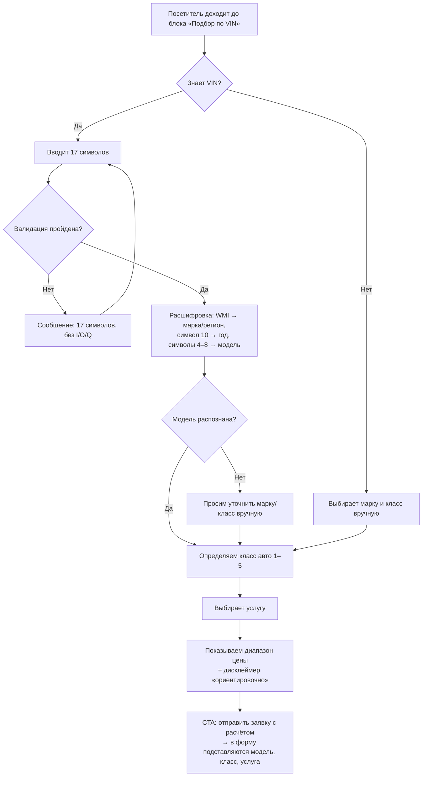
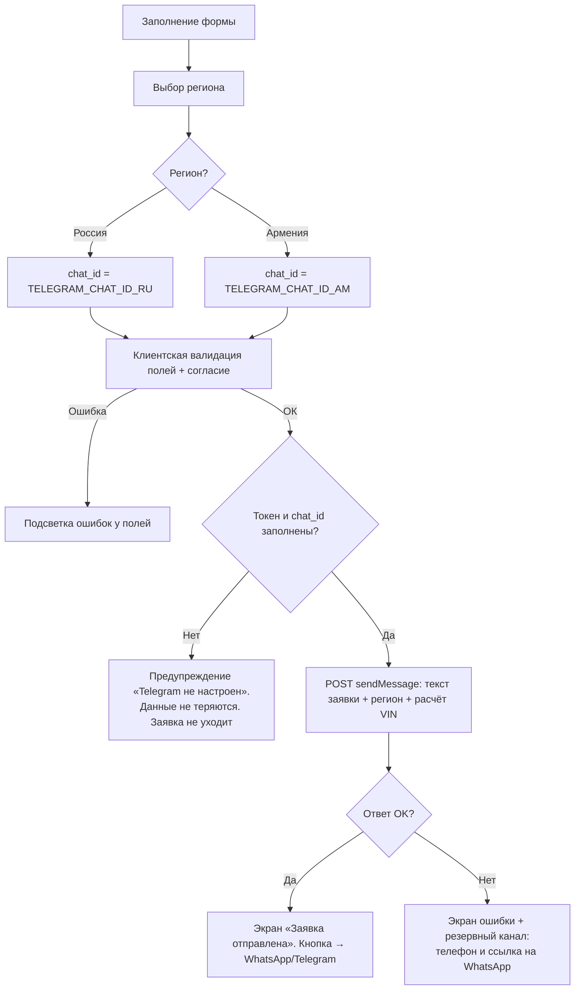
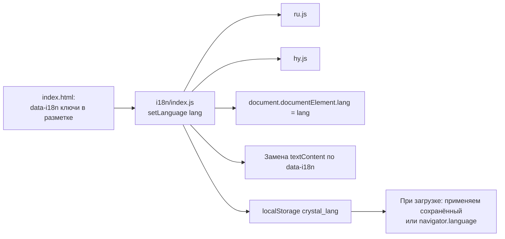

# PRD — Сайт детейлинг-центра «Crystal»

| Поле | Значение |
|---|---|
| **Язык документа** | Русский |
| **Языки сайта** | `ru` (основной), `hy` (армянский) |
| **Стек** | Статический сайт: HTML5 + CSS3 + Vanilla JS (ES6 modules), без сборщика |
| **Хостинг** | Статика (Vercel / Netlify / GitHub Pages / любой nginx) — уточняется |
| **Имя проекта** | `crystal-detailing` |
| **Тип PRD** | Простой (без конкурентного анализа — по требованию заказчика) |
| **Дата** | 2026-11-09 |
| **Статус** | Draft v1.0 — на согласование |

---

## 1. Исходная потребность (реконструкция запроса)

Детейлинг-центр **Crystal** (Липецк, Универсальный проезд, 1Г) работает в премиальном сегменте и расширяется на рынок Армении. Есть потребность в собственном сайте, который:

1. выглядит как премиальный бренд (тёмная «люксовая» автомобильная эстетика) и вызывает доверие уровня BMW/Mercedes-сервиса;
2. показывает работы (галерея) — визуальное доказательство качества вместо слов;
3. даёт клиенту прозрачный ориентир по цене ещё **до** звонка — через VIN-подбор класса авто;
4. работает на двух языках (`ru`, `hy`) — для клиентов в РФ и Армении;
5. собирает заявки и разводит их по двум Telegram-чатам (РФ / Армения), чтобы менеджеры двух филиалов не путали лиды;
6. закрывает юридические требования **двух юрисдикций** (РФ и Армения) по персональным данным и cookie.

**Ключевое ограничение проекта:** сайт сдаётся как **шаблон с placeholder'ами**. Контент (логотип, фото, контакты Армении, соцсети, юр. реквизиты, токен Telegram) заказчик подставляет сам. Код должен быть полностью работоспособен до подстановки — с честными предупреждениями вместо падений.

---

## 2. Продуктовые цели

Три ортогональные цели:

| # | Цель | Что означает на практике | Метрика успеха |
|---|---|---|---|
| **G1** | **Премиальное восприятие бренда** | Сайт неотличим по уровню от сайтов люксовых детейлинг-студий: тёмная палитра, крупная типографика, аккуратная анимация, отсутствие «дешёвых» элементов | Качественная оценка заказчика: «выглядит дорого». Технически: Lighthouse Performance ≥ 85, Accessibility ≥ 90, нет CLS-скачков |
| **G2** | **Прозрачный вход в сделку** | Посетитель за 30–60 секунд понимает: что делают, сколько стоит, как записаться. VIN-калькулятор и форма заявки — главный конверсионный путь | Заявка отправляется за ≤ 3 действия от первого экрана (услуга → VIN/модель → контакты) |
| **G3** | **Корректная работа в двух юрисдикциях** | Один код, два языка, два Telegram-чата, два набора правовых текстов. Клиент из Еревана и из Липецка пользуются одним сайтом без путаницы | 100% заявок попадают в «свой» чат; 0 юридических блоков-заглушек без чек-листа |

**Anti-goals (что НЕ делаем):** интернет-магазин с оплатой, личный кабинет, онлайн-запись со слотами, CMS-админка, блог, многостраничная структура с роутингом. Это одностраничник (long-read landing) с анкорной навигацией.

---

## 3. Пользовательские истории

| ID | Роль | Хочу | Чтобы |
|---|---|---|---|
| **US-01** | Владелец авто в Липецке (премиум-сегмент) | Увидеть, что здесь работают на уровне бренда, и понять порядок цен | Решить, доверять ли машину и стоит ли ехать |
| **US-02** | Владелец авто, знающий только VIN | Ввести VIN и получить класс авто и диапазон цены | Не звонить ради «а сколько будет стоить?» и не переспрашивать модель |
| **US-03** | Клиент из Армении | Открыть сайт на армянском, увидеть армянский телефон и отправить заявку | Заявка попала к менеджеру в Армении, а не в Липецк |
| **US-04** | Посетитель, предпочитающий мессенджер | Нажать крупную кнопку WhatsApp/Telegram и написать в один клик | Не заполнять форму, если не хочется |
| **US-05** | Юридически внимательный посетитель | Прочитать, как обрабатываются мои данные, и дать явное согласие | Доверять сайту и понимать свои права по законодательству своей страны |
| **US-06** | Заказчик (владелец бизнеса) | Заменить логотип, фото и контакты, не трогая логику | Самостоятельно обновлять контент |

---

## 4. Пул требований

Приоритеты: **P0** — must have (без этого релиз невозможен), **P1** — should have (делаем в этой итерации, если не блокирует), **P2** — could have (после релиза / если останется время).

### 4.1 Контент и структура

| ID | Prio | Требование | Критерий приёмки |
|---|---|---|---|
| R-01 | P0 | Одностраничный сайт с анкорной навигацией: Hero → Услуги и цены → VIN-калькулятор → Галерея → Преимущества → Форма заявки → Контакты → Footer (юр. блок) | Все секции присутствуют, скролл работает, анкоры из меню ведут в правильные секции |
| R-02 | P0 | Тёмная премиальная палитра (глубокий чёрный/графит + металлические акценты), крупная типографика, много воздуха | Единая CSS-переменная палитра; нет белых «плоских» блоков, выбивающихся из стиля |
| R-03 | P0 | Секция «Услуги и цены» с реальными позициями заказчика | Отображены ≥ 3 услуги: Антихром (от 20 000 ₽), Комплексная детейлинг-мойка, 2 класс — 8 500 ₽, Детейлинг подкапотного пространства, 3 класс — 6 000 ₽. Цены видны без раскрытия аккордеона |
| R-04 | P0 | Галерея работ: сетка placeholder-слотов с подписями и инструкцией по замене | ≥ 6 слотов; в разметке/README явно указано `assets/gallery/photo-1.jpg … photo-N.jpg`, формат, рекомендуемые размеры (напр. 1600×1200, JPG, ≤ 400 КБ) |
| R-05 | P0 | Блок преимуществ/доверия (оплата картой, парковка, химчистка, предварительная запись, подарочные сертификаты, категории: детейлинг / оклейка / тюнинг) | Все перечисленные особенности отображены |
| R-06 | P1 | Блок контактов с картой/ссылкой на Яндекс.Карты (Липецк, Универсальный проезд, 1Г; ежедневно до 20:00) | Адрес, часы и телефон РФ `+7 (915) 550-17-77` присутствуют; ссылка на карту открывается |
| R-07 | P2 | Галерея «до/после» со слайдером | Слайдер работает мышью и с клавиатуры |

### 4.2 Мультиязычность (ru / hy)

| ID | Prio | Требование | Критерий приёмки |
|---|---|---|---|
| R-10 | P0 | Переключатель языка `RU / HY` в шапке, видимый на всех разрешениях | Клик меняет язык без перезагрузки страницы |
| R-11 | P0 | Все текстуальные узлы вынесены в словари `js/i18n/ru.js` и `js/i18n/hy.js` (плоские ключи) | В HTML/CSS нет «зашитых» пользовательских строк; grep по разметке не находит русский текст вне словарей |
| R-12 | P0 | Армянский перевод — качественный, литературный (не машинный). Термины детейлинга — общепринятые в армянской автолексике | Заказчик/носитель языка подтверждает перевод. Машинный перевод как финальный результат **не принимается** |
| R-13 | P0 | Выбор языка сохраняется (`localStorage`), применяется при повторном заходе | После reload язык сохраняется |
| R-14 | P0 | Учитывается `lang` документа: `<html lang="ru">` / `<html lang="hy">`; шрифт поддерживает армянскую графику (Noto Sans Armenian в стеке) | Армянские буквы рендерятся без «тофу»-квадратов |
| R-15 | P1 | Автоопределение языка по `navigator.language` при первом заходе, с обязательной возможностью переключить вручную | Посетитель с `hy-*` локалью видит армянский, но переключатель не «залипает» и доступен |
| R-16 | P2 | Язык в URL (`?lang=hy` или `/hy/`) для ссылок из рекламы | Прямая ссылка открывает нужный язык |

### 4.3 VIN-калькулятор

| ID | Prio | Требование | Критерий приёмки |
|---|---|---|---|
| R-20 | P0 | Отдельный модуль `js/vin/` с чётким публичным интерфейсом, не связанный с UI | Модуль можно импортировать и вызвать без DOM; логика покрыта простыми тестами/чек-листом |
| R-21 | P0 | Локальная офлайн-расшифровка VIN: WMI (символы 1–3) → марка/регион; символ 10 → год; символы 4–8 → модель/двигатель где возможно | Ввод валидного тестового VIN даёт марку и год без сетевых запросов |
| R-22 | P0 | Маппинг «модель → класс авто 1–5» (по габаритам/сегменту) в отдельной таблице данных | Таблица вынесена в конфиг/данные, редактируется без правки логики |
| R-23 | P0 | Итог = базовая цена услуги × множитель класса | Формула задокументирована; ручная проверка 3 примеров совпадает |
| R-24 | P0 | Валидация: длина 17 символов, запрет `I/O/Q`, понятные сообщения об ошибке | Ввод `123` и `1HGCM82633A00I123` даёт разные осмысленные ошибки |
| R-25 | P0 | Результат — **диапазон** цены с дисклеймером «ориентировочно, точная цена после осмотра» | Ориентировочность явно указана рядом с числом |
| R-26 | P0 | Архитектурный шов под внешний API (Vincario/NHTSA/ иной): провайдер за интерфейсом, локальная реализация по умолчанию | В `config.js` есть флаг провайдера (`local` / `api`); переключение не требует переписывания UI |
| R-27 | P1 | Fallback: если VIN не распознан — предложить выбрать марку/класс вручную из списка | Путь вручную всегда доступен, форма заявки не блокируется |
| R-28 | P2 | Справочный тултип «где найти VIN» (схема расположения) | Тултип есть у поля ввода |

### 4.4 Форма обратной связи и маршрутизация Telegram

| ID | Prio | Требование | Критерий приёмки |
|---|---|---|---|
| R-30 | P0 | Поля формы: **имя**, **телефон**, **модель автомобиля** (+ опционально: регион, услуга из калькулятора, комментарий, согласие) | Поля присутствуют, обязательные помечены |
| R-31 | P0 | Выбор региона/филиала: **Россия (Липецк)** / **Армения** — обязательный явный выбор, влияющий на маршрут | Без выбранного региона отправка невозможна либо регион обязателен по умолчанию = РФ с явным отображением |
| R-32 | P0 | Маршрутизация заявки в Telegram-чат по региону: РФ → `TELEGRAM_CHAT_ID_RU`, Армения → `TELEGRAM_CHAT_ID_AM` | При выборе Армении запрос уходит только в чат Армении (проверено логом/тестом) |
| R-33 | P0 | Токен и chat_id — в `js/config.js` как placeholder'ы. Пока не заполнены — форма показывает **предупреждение**, а не падает | В демо-режиме видно сообщение вида «Telegram не настроен»; консоль без необработанных исключений |
| R-34 | P0 | Клиентская валидация: имя ≥ 2 символов, телефон в допустимом формате, модель заполнена, чекбокс согласия отмечен | Отправка с пустыми/битыми полями невозможна, ошибки видны у полей |
| R-35 | P1 | Маска/нормализация телефона с учётом префиксов РФ (`+7`) и Армении (`+374`) | Ввод армянского номера не «ломает» маску РФ |
| R-36 | P1 | Состояния кнопки: idle → sending → success / error; защита от двойной отправки | Дабл-клик не создаёт две заявки |
| R-37 | P1 | Honeypot-поле или минимальная анти-спам защита | Бот-автозаполнение не приводит к отправке |
| R-38 | P1 | Сообщение в Telegram содержит: регион, имя, телефон, модель, класс авто и ориентир цены (если считали VIN), выбранную услугу, язык сайта, timestamp | Менеджер получает всё необходимое для обратного звонка |
| R-39 | P2 | Дублирование заявки на email или в резервный чат | При недоступности Telegram есть второй канал |

### 4.5 Мессенджеры и соцсети

| ID | Prio | Требование | Критерий приёмки |
|---|---|---|---|
| R-40 | P0 | Крупные заметные кнопки: WhatsApp, Telegram, Instagram — в шапке (или плавающе) и в контактах | Три кнопки, размер тач-зоны ≥ 44×44 px, читаемые подписи |
| R-41 | P0 | Ссылки — placeholder'ы с явной пометкой «[ЗАПОЛНИТЬ]» в `config.js` | Пока ссылка пуста — кнопка визуально неактивна/ведёт в никуда без ошибки |
| R-42 | P1 | `target="_blank" rel="noopener"` для внешних ссылок | Проверено в разметке |
| R-43 | P2 | Плавающая кнопка WhatsApp на мобильных | Присутствует на ≤ 768 px |

### 4.6 Юридический блок

| ID | Prio | Требование | Критерий приёмки |
|---|---|---|---|
| R-50 | P0 | Cookie-баннер (согласие на использование cookie): показывается при первом визите, скрывается после принятия, выбор запоминается | Баннер появляется один раз; после «Принять» не возвращается после reload |
| R-51 | P0 | Возможность **отказаться** от необязательных cookie (не только «Принять») | Рядом с «Принять» есть «Отклонить» и/или «Настроить» |
| R-52 | P0 | Согласие на обработку персональных данных — обязательный чекбокс формы со ссылкой на политику | Без галочки отправка блокируется |
| R-53 | P0 | Текст согласия покрывает **обе юрисдикции**: РФ (152-ФЗ) и Армения (Закон РА № ЗР-49 от 18.05.2015) | В тексте явно названы оба закона и оба оператора (при наличии двух юрлиц) |
| R-54 | P0 | Отдельная страница/модальное окно «Политика конфиденциальности» (ru + hy) | Открывается из формы, из cookie-баннера и из footer |
| R-55 | P0 | Доступны разделы: оператор ПДн, состав данных, цели, правовые основания, сроки хранения, права субъекта, порядок отзыва согласия, контакты для обращений | Все пункты присутствуют в обеих языковых версиях |
| R-56 | P0 | Для армянского сегмента — отражена специфика Закона РА (право на отзыв согласия, обращение к оператору, при необходимости — в уполномоченный орган) | Пункт про отзыв и обращение присутствует |
| R-57 | P1 | Указание места хранения/обработки данных и трансграничной передачи (данные уходят в Telegram — сторонний сервис) | Раскрыто, что заявка передаётся через Telegram |
| R-58 | P1 | Дата последнего обновления политики | Указана в документе |
| R-59 | P2 | Cookie-политика как отдельный раздел/таблица с перечнем используемых cookie | Таблица: имя, назначение, срок |

### 4.7 Технические / кросс-функциональные

| ID | Prio | Требование | Критерий приёмки |
|---|---|---|---|
| R-60 | P0 | Без сборки: открывается как файл/через простой статический сервер, зависимости — только CDN или отсутствуют | `index.html` работает после `npx serve` без билд-шага |
| R-61 | P0 | Адаптивность: 360 / 768 / 1280 / 1920 px | Нет горизонтального скролла, ничего не «наезжает» |
| R-62 | P0 | Все конфигурируемые значения (телефоны, chat_id, соцсети, реквизиты) — в `js/config.js` с комментариями | Единственная точка правки контента помимо текстов |
| R-63 | P0 | Полностью отсутствуют выдуманные данные: нет фейковых номеров, ссылок, реквизитов — только placeholder'ы `[ЗАПОЛНИТЬ]` | Ревью: ни одного правдоподобного, но недостоверного значения |
| R-64 | P1 | Семантический HTML, alt у изображений, навигация с клавиатуры, контраст текста ≥ 4.5:1 | Lighthouse Accessibility ≥ 90 |
| R-65 | P1 | Метатеги: title, description, OG-теги для шаринга | Ссылка корректно разворачивается в мессенджере |
| R-66 | P1 | Производительность: изображения lazy-load, шрифты без блокировки рендера | LCP ≤ 2.5 c на 4G |
| R-67 | P2 | README с инструкцией: где заменить логотип, фото, контакты, как заполнить Telegram и юр. тексты | Непрограммист может пройти по чек-листу |

---

## 5. Структура страниц и UI

Файловая структура (зафиксирована):

```
crystal-detailing/
├── index.html
├── css/
│   └── style.css
├── js/
│   ├── config.js          ← всё настраиваемое: Telegram, телефоны, соцсети, реквизиты
│   ├── i18n/
│   │   ├── ru.js
│   │   └── hy.js
│   ├── vin/
│   │   ├── decoder.js     ← WMI / год / модель
│   │   ├── classes.js     ← модель → класс 1–5, множители
│   │   └── provider.js    ← шов под внешний API
│   ├── calculator.js      ← связка VIN ↔ UI
│   ├── form.js            ← валидация + маршрутизация Telegram
│   └── main.js            ← инициализация, i18n, cookie
├── assets/
│   ├── logo-placeholder.svg
│   └── gallery/           ← photo-1.jpg … photo-N.jpg
└── docs/
    └── PRD.md
```

### 5.1 Секции страницы (сверху вниз)

| # | Секция | Содержание | UI-заметки |
|---|---|---|---|
| 1 | **Header (sticky)** | Логотип, анкорное меню, переключатель RU/HY, кнопка «Записаться» | Полупрозрачный, размытие под тёмным фоном |
| 2 | **Hero** | Крупный заголовок бренда, 1 строка оффера, 2 CTA: «Рассчитать по VIN» / «Смотреть работы», статус «Липецк · ежедневно до 20:00» | Полноэкранный, фоновое премиум-фото (placeholder), тёмный градиент-overlay |
| 3 | **Услуги и цены** | Карточки услуг с ценой «от», категории (детейлинг / оклейка / тюнинг) | 3–4 карточки, hover-подъём, цена крупно |
| 4 | **VIN-калькулятор** | Поле VIN, выбор услуги, результат: марка/год/класс + диапазон цены, дисклеймер, CTA «Отправить заявку с этим расчётом» | Отдельный акцентный блок, «умный» вид |
| 5 | **Галерея работ** | Сетка placeholder-изображений с подписями | ≥ 6 слотов, masonry или 3-колоночная сетка |
| 6 | **Преимущества** | 6 иконок: оплата картой, парковка, химчистка, предзапись, сертификаты, опыт | Иконки + короткие подписи |
| 7 | **Форма заявки** | Регион (РФ/Армения), имя, телефон, модель, комментарий, согласие, кнопка | Единственная форма на сайте |
| 8 | **Контакты** | Адрес Липецка, часы, телефон РФ, телефон Армении `[ЗАПОЛНИТЬ]`, ссылка на карту, крупные кнопки мессенджеров | Два контактных блока: РФ и Армения |
| 9 | **Footer** | Копирайт, реквизиты `[ЗАПОЛНИТЬ]`, ссылки на политику и cookie-политику, повтор соцсетей | Мелкий текст, приглушённые тона |
| — | **Cookie-баннер** | Фиксирован внизу, «Принять» / «Отклонить», ссылка на политику | Не перекрывает CTA на мобильных |
| — | **Плавающие соцсети** | WhatsApp / Telegram / Instagram | Правый нижний угол, на мобильных — крупнее |

### 5.2 Дизайн-направление

| Токен | Значение (предложение, финально — архитектор/дизайнер) |
|---|---|
| Фон | `#0A0A0C` / `#111114` (глубокий графит) |
| Поверхности | `#18181C`, границы `rgba(255,255,255,0.08)` |
| Акцент | Металлик-графит/серебро `#C9CDD3` + тёплый люкс-акцент (шампань/янтарь) |
| Текст | `#F5F5F7` основной, `#A1A1AA` вторичный |
| Шрифты | Заголовки — геометрический sans премиум-класса; текст — Inter / Manrope; **армянский — Noto Sans Armenian** в стеке |
| Радиусы/тени | Мягкие скругления, сдержанные тени, без «неона» |

---

## 6. Логика VIN-калькулятора (с точки зрения пользователя)

### 6.1 Пользовательский поток



### 6.2 Формула

```
Итоговая цена (ориентир) = Базовая цена услуги × Множитель класса × Коэффициент сложности (опц.)

где Класс авто: 1 — компакт / 2 — седан, кроссовер малый / 3 — кроссовер, джип, внедорожник /
                4 — премиум, крупный внедорожник / 5 — эксклюзив, суперкар, нестандарт
```

**Диапазон** показывается как `[Итог × 0.9 … Итог × 1.2]`, округлённый до сотен, с подписью «Ориентировочно. Точная стоимость — после осмотра автомобиля».

**Опорные точки из данных заказчика** (используются как калибровка базовых цен): комплексная детейлинг-мойка для класса 2 = 8 500 ₽; детейлинг подкапотного пространства для класса 3 = 6 000 ₽; антихром — «от 20 000 ₽» (зависит от сложности, цена не масштабируется множителем класса линейно — фиксируется как «от»).

### 6.3 Архитектурный шов под внешний API

```js
// js/vin/provider.js — контракт
// { decode(vin) -> { make, year, model, region, confidence, source } }
const provider = config.vinProvider === 'api'
  ? apiProvider(config.vinApiEndpoint, config.vinApiKey)
  : localProvider();

// UI вызывает только provider.decode(vin) и никогда не знает, откуда данные.
```

Требования к шву: (1) единый контракт результата; (2) поле `source` для отладки; (3) таймаут и graceful fallback на локальный декодер при ошибке API; (4) ключ API — в `config.js` как placeholder.

### 6.4 Известные ограничения (честно фиксируем в UI/PRD)

Локальная расшифровка по WMI покрывает далеко не все марки; символы 4–8 дают модель лишь для части производителей; 10-й символ — год, но кодировка различается для до 2000 / после 2010. Поэтому обязателен путь «выбрать класс вручную» (R-27), а результат подаётся как **ориентир**, а не как расчёт.

---

## 7. Логика маршрутизации заявок в Telegram

### 7.1 Как пользователь выбирает регион

Регион — **обязательное явное поле** в форме (переключатель из двух сегментов над полями), потому что от него зависит и чат, и контактные данные. Предлагаемое поведение:

- по умолчанию активен **Россия (Липецк)** — основной рынок;
- переключение на **Армения** меняет: (а) целевой chat_id, (б) подсказку формата телефона, (в) при наличии — блок армянского адреса;
- выбранный регион отображается в шапке формы словами («Ваша заявка уйдёт менеджеру в Липецке» / «…в Армении») — снимает страх «не туда отправил»;
- если пользователь считал VIN и выбрал услугу — регион переносится из контекста, но остаётся редактируемым.

### 7.2 Поток отправки



### 7.3 Демо-режим (важно)

Пока в `config.js` стоят placeholder'ы, форма **не должна** ни падать, ни отправлять в никуда молча. Требуется явное предупреждение вида: *«Отправка в Telegram не настроена: заполните `TELEGRAM_BOT_TOKEN` и `TELEGRAM_CHAT_ID_RU / _AM` в `js/config.js`»* — видимое либо в UI, либо в консоли в зависимости от выбранного режима (архитектор уточнит: показывать ли посетителю). Дополнительно должно логироваться, **в какой чат** ушла бы заявка (для отладки маршрутизации).

### 7.4 Состав сообщения в Telegram

`Регион · Имя · Телефон · Модель · Класс авто · Ориентир цены · Услуга · Язык сайта · Время`. Для армянского сегмента телефон — в формате `+374 …`.

---

## 8. Требования к юридическому блоку

### 8.1 Что требуется по закону РФ (152-ФЗ «О персональных данных»)

1. **Согласие на обработку ПДн** — конкретное, информированное, отдельное от иных согласий (не «мелким шрифтом»).
2. **Идентификация оператора**: наименование юрлица/ИП, ИНН/ОГРН, адрес — `[ЗАПОЛНИТЬ]`.
3. **Состав данных**: имя, телефон, модель автомобиля, регион, свободный комментарий, IP и технические данные (cookie).
4. **Цели обработки**: обратный звонок, согласование записи, информирование об услугах.
5. **Правовое основание**: согласие субъекта.
6. **Срок хранения** и **порядок уничтожения** данных.
7. **Права субъекта**: доступ, уточнение, блокирование, удаление, отзыв согласия.
8. **Порядок отзыва согласия** — конкретный адрес/канал для письменного отзыва.
9. **Контакты для обращений** по вопросам ПДн.
10. **Cookie**: уведомление и согласие на использование cookie (обязательное требование практики Роскомнадзора; для необязательных — отдельный отказ).
11. **Трансграничная передача / передача третьим лицам**: заявка идёт через Telegram (сторонний сервис) — требуется раскрытие в политике.
12. **Публикация политики** в открытом доступе на сайте (ru + hy).

### 8.2 Что требуется по закону Армении (Закон РА № ЗР-49 от 18.05.2015 «О защите персональных данных»)

1. **Согласие субъекта** на обработку — свободное, конкретное, осознанное; для сайта — через явный чекбокс.
2. **Идентификация ответственного лица / оператора** (контролёра данных) — армянское юрлицо или указание, кто отвечает за данные армянских клиентов: `[ЗАПОЛНИТЬ]`.
3. **Цели и состав данных** — раскрываются в политике; принцип минимизации (не собираем лишнее).
4. **Права субъекта**: получение информации об обработке, доступ к своим данным, **исправление**, **блокирование/удаление**, **отзыв согласия**, обжалование.
5. **Порядок реализации прав**: как и куда обратиться, сроки ответа оператора.
6. **Отзыв согласия** — отдельно описанная процедура; после отзыва обработка прекращается (кроме случаев, предусмотренных законом).
7. **Обращение в уполномоченный орган** — указание на право жалобы в надзорный орган РА.
8. **Уведомление/регистрация** в уполномоченном органе, если требуется для данного характера обработки — `[ПРОВЕРИТЬ С ЮРИСТОМ]`.
9. **Трансграничная передача данных** — данные армянских клиентов уходят в Telegram; требуется раскрытие и, возможно, дополнительное основание.
10. **Хранение данных** — сроки и локация.

### 8.3 Общие требования реализации

| ID | Требование | Критерий приёмки |
|---|---|---|
| L-01 | Cookie-баннер с «Принять» / «Отклонить» (и опционально «Настроить»), запоминание выбора | Работает, не мешает навигации |
| L-02 | Cookie-баннер на обоих языках | Текст берётся из i18n |
| L-03 | Необязательные cookie (аналитика) не ставятся до согласия | Проверено в DevTools |
| L-04 | Обязательный чекбокс согласия у формы, отдельный от подписки на рассылку | Отправка заблокирована без галочки |
| L-05 | Ссылки на политику из формы, cookie-баннера и footer | Все три точки входа работают |
| L-06 | Политика существует в версиях ru и hy, обе полные | Ни один раздел не остаётся только на одном языке |
| L-07 | В политике названы **оба** закона (152-ФЗ и ЗР-49) и указаны оба оператора (если два юрлица) | Присутствует явно |
| L-08 | Реквизиты — placeholder'ы с пометкой в чек-листе, не выдуманные значения | Ревью пройдено |
| L-09 | Отзыв согласия: указан канал обращения | Раздел присутствует |
| L-10 | Раскрыта передача данных через Telegram | Раздел «третьи лица» заполнен |
| L-11 | Тексты согласия согласованы с юристом перед публикацией | Отметка в чек-листе приёмки |

**Важно:** PRD описывает, *какие* блоки обязаны присутствовать. Финальные формулировки — за юристом заказчика. Сайт не должен публиковаться с placeholder-реквизитами в юридических текстах.

---

## 9. Схема мультиязычности



Правила:
- ключи — плоские, в нотации `section.element` (`hero.title`, `form.consent`, `calc.vintage`);
- тексты интерполируются простой подстановкой `{value}`;
- `data-i18n` для текста, `data-i18n-placeholder` для placeholder'ов, `data-i18n-aria` для aria-label;
- **все** строки, включая сообщения об ошибках формы и юридические тексты, проходят через i18n;
- отсутствующий ключ откатывается на `ru` и пишет предупреждение в консоль (не оставляет пустоту);
- армянский перевод — отдельная задача с носителем языка; PRD требует, чтобы словарь `hy.js` проходил вычитку (иначе машинный перевод недопустим).

---

## 10. Требуется от заказчика (placeholders)

Всё ниже — блокеры финальной приёмки. До получения сайт работает, но с явными пометками.

| # | Что требуется | Где используется | Формат / требования | Приоритет |
|---|---|---|---|---|
| 1 | **Логотип Crystal** | Header, Footer, favicon | SVG (предпочтительно) или PNG с прозрачностью, ≥ 512 px | Блокер релиза |
| 2 | **Фото для галереи** (≥ 6) | Секция «Галерея» | JPG, 1600×1200, ≤ 400 КБ каждое, единая обработка (заказчик берёт с Яндекс.Карт) | Блокер релиза |
| 3 | **Фоновое фото Hero** (опц.) | Первый экран | 2400×1350 JPG | Желательно |
| 4 | **Telegram Bot Token** | `config.js` | От @BotFather | Блокер формы |
| 5 | **Chat ID для РФ** | `config.js` (`TELEGRAM_CHAT_ID_RU`) | ID группы/канала заявок РФ | Блокер формы |
| 6 | **Chat ID для Армении** | `config.js` (`TELEGRAM_CHAT_ID_AM`) | ID группы/канала заявок Армении | Блокер формы |
| 7 | **Телефон Армении** | Контакты, форма, WhatsApp | Формат `+374 …` | Блокер |
| 8 | **Адрес в Армении** (если есть филиал) | Контакты | Точный адрес | Уточнить |
| 9 | **Ссылка WhatsApp** | Кнопки соцсетей, форма | `https://wa.me/<номер>` | Блокер |
| 10 | **Ссылка Telegram** | Кнопки соцсетей | `https://t.me/<аккаунт>` | Блокер |
| 11 | **Ссылка Instagram** | Кнопки соцсетей | URL профиля | Блокер |
| 12 | **Юр. реквизиты РФ** | Footer, Политика | Наименование, ИНН, ОГРН, юр. адрес | Блокер публикации |
| 13 | **Юр. реквизиты Армении** | Footer, Политика | Наименование, ՀՎՀՀ (налоговый номер), адрес | Блокер публикации |
| 14 | **Полный прайс-лист** | Услуги, калькулятор | Все позиции + базовые цены по классам | Важно для калькулятора |
| 15 | **Точный адрес Яндекс.Карт / координаты** | Контакты, карта | Ссылка или lat/long | Важно |
| 16 | **Финальные тексты** о компании, преимуществах, услугах | Все секции | ru + hy | Блокер релиза |
| 17 | **Вычитка армянского перевода** носителем языка | i18n `hy.js`, политика | Подтверждение качества | Блокер релиза |
| 18 | **Юридические формулировки** согласия и политики | Юр. блок | Согласование с юристом по обеим юрисдикциям | Блокер публикации |
| 19 | **Контакт для отзыва согласия** (email/адрес) | Политика | Обе страны | Блокер публикации |
| 20 | **Логотип/иконки мессенджеров** | Кнопки соцсетей | SVG | Желательно |
| 21 | **Подарочные сертификаты** — номинал, условия | Блок преимуществ | Текстом | Уточнить |
| 22 | **Аналитика** (если нужна) — GA/Метрика ID | Cookie-блок | ID счётчика | После релиза |

---

## 11. Открытые вопросы

| # | Вопрос | Почему важно | Кому |
|---|---|---|---|
| Q1 | Есть ли **отдельное юрлицо** в Армении, или заявки идут от российского лица? | Определяет, сколько операторов ПДн указывать и чей чат ведёт армянские лиды | Заказчику |
| Q2 | Сколько базовых цен — **одна на услугу** или матрица «услуга × класс»? | Без матрицы множитель класса даёт неточный ориентир | Заказчику (нужен прайс) |
| Q3 | Множители классов 1–5 — задаёт заказчик или берём предложенные по умолчанию? | Влияет на доверие к калькулятору | Заказчику |
| Q4 | Класс авто считать по **габаритам/сегменту** или по рыночной категории бренда? | Разные подходы дадут разный результат на одном VIN | Заказчику/архитектору |
| Q5 | Армения — это **филиал**, **партнёр** или только приём заявок? | Влияет на контакты, часы, юр. блок | Заказчику |
| Q6 | Показывать ли посетителю предупреждение о ненастроенном Telegram, или только в консоль? | UX демо против честности | Архитектору |
| Q7 | Нужен ли email-дубль заявок (R-39)? | Резервный канал при сбое Telegram | Заказчику |
| Q8 | Хостинг и домен? | HTTPS, редиректы, где хранятся ключи | Заказчику |
| Q9 | Требуется ли регистрация/уведомление в уполномоченном органе РА? | Возможная юр. обязанность | Юристу заказчика |
| Q10 | Армянский — только `hy`, или нужен ещё и `en` для туристов? | Влияет на объём словарей | Заказчику |
| Q11 | Точный график (сейчас — «до 20:00»): без выходных? | Контакты и доверие | Заказчику |
| Q12 | Нужны ли онлайн-оплата/предоплата? | Сейчас вне скоупа; уточнить, не расширяем ли объём | Заказчику |

---

## 12. Что должен уточнить архитектор

Технические решения, которые PRD намеренно не фиксирует и передаёт архитектору:

1. Способ отправки в Telegram без бэкенда: `fetch` к Bot API из браузера (раскрывает токен — риск) vs. минимальный serverless-прокси. **Это ключевая развилка по безопасности.** Рекомендация: прокси или serverless-функция, токен не в клиенте.
2. Структура `config.js` и механизм подстановки placeholder'ов.
3. Базовая матрица цен по классам (значения по умолчанию) и таблица множителей.
4. Степень детализации локальной таблицы WMI и списка моделей.
5. Реализация cookie-логики до подключения аналитики.
6. Стратегия обработки юридических текстов: отдельные HTML-фрагменты или разделы в словарях i18n.

---

*PRD v1.0 · Простой формат (без конкурентного анализа) · Подготовил: продуктовый менеджер*
